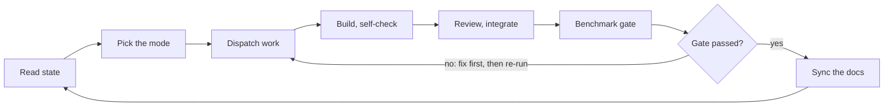

# Agent team and workflow

Drafted 13 October 2026 from the project plan in [PLAN.md](PLAN.md). It names the agents, what each one owns, the skills they share, the files they hand each other, the cycle they run, and the priority modes that decide who is active in a given cycle.

The agents live in `.claude/agents/`, the skills in `.claude/skills/`, the contracts in `contracts/`, the board in `board/`, the ledger in `ledger/`.

## Summary

Thirteen agents in three tiers build and police the pipeline the plan describes: one **lead** that owns the plan, the task board and the shared contracts; eight **specialists**, one per pipeline step; and four **guardians** that cut across every step. Twelve reusable **skills** carry the procedures every agent repeats. The team moves in short cycles tied to the roadmap's three gates. A **priority mode** decides which agents are active in a cycle, and a short list of **priority rules** orders the work inside it. Three controls keep it honest: the benchmark ledger, the gates, and the human's blind listening sign-off.

What no agent can do: listen. Every metric is a proxy. The final gate for any tone is a blind listening test run by a person, which the benchmark agent prepares but cannot score. The human is also the only hand on the pedal, the only buyer of licences, and the only judge of the legal calls.

## Three tiers and one human

- **Lead** — `tone-matcher-lead`. Owns the plan doc, the task board, the contracts and the cycle itself. Decides the priority mode each cycle and writes results back into the doc.
- **Specialists** — one per step: `separation`, `dry-signal`, `native-engine`, `stomp-engine`, `preset`, `tone-metrics`, `search`, `learning`.
- **Guardians** — `benchmark`, `research`, `platform`, `reviewer`. They own no step, but every step passes through them.
- **Human** — the listener, the hardware operator, the licence holder, the gate signer.

## Agent roster

| Agent | Tier | Owns (plan section) | Specialty | Delivers | Model |
|---|---|---|---|---|---|
| `tone-matcher-lead` | Lead | Whole plan; Scope, Roadmap, Risks, Open questions | Task decomposition, contract ownership, prioritization, writing results and decisions back to the doc | Task board, the mode for each cycle, decision log, contract versions | Opus |
| `separation` | Specialist | Step 1, Step 2 | Separator backends (BS/Mel-RoFormer, MDX23C, htdemucs_6s), GPU backend detection (CUDA, MPS, ROCm, CPU), user-supplied stems, clustering into at most 3 snapshot groups, separation-consistent recombine-and-re-separate | `separate` skill, stems cache, a section map per song, artifact-confidence masks | Sonnet |
| `dry-signal` | Specialist | Step 3 | Reference DI library (EGDB), matching clips to a tone by register and style, user-DI capture over USB 5/6; later, blind DI recovery | DI picker, DI library index, capture flow | Sonnet |
| `native-engine` | Specialist | Step 4, Native mode | pedalboard hosting, Native's saved state, the 16+16 automation slots, MIDI CC, Wine and yabridge on Linux | Native implementation of the engine interface, a render service, measured `cost()` | Opus for the week-1 spike, then Sonnet |
| `stomp-engine` | Specialist | Step 4, HX Stomp mode; Step 7 reamp | fretwire USB protocol, the port to Windows and macOS, MIDI CC on template presets, USB audio reamp, latency calibration | Stomp implementation of the engine interface, `reamp-capture` skill | Opus for the week-1 spike, then Sonnet |
| `preset` | Specialist | Step 5; Step 7 generate and validate | `.hlx` JSON, catalog import from HX Edit, the 8-slot template, DSP budget and amp/cab pairing rules, snapshot model-sharing rule, full-rig and effects-only export, golden templates | Preset schema, `hlx-validate` and `catalog-import` skills, the exporter | Sonnet |
| `tone-metrics` | Specialist | Step 6, losses | Spectral tilt, crest factor, envelope statistics, direct measurement of delay, reverb and modulation, learned embeddings (AFx-Rep, Fx-Encoder++, Open-Amp), multi-resolution STFT, artifact-robust and confidence-masked variants | A loss kit behind one interface, and the proof that each loss can be trusted | Opus |
| `search` | Specialist | Step 6, search | Seed, beam over models, CMA-ES or Bayesian refinement, final check; per-engine budgets; successive halving; the Gaussian prior over presets | An optimizer that takes an engine and a loss kit and returns ranked presets with scores | Sonnet |
| `learning` | Specialist | How it learns | Bulk render data generation, the blind predictor, the learned similarity metric, neural proxies, the flywheel pipeline; model cards and licence notes for published weights | Predictor and metric checkpoints, training scripts, the data generator | Opus |
| `benchmark` | Guardian | Evaluation plan; the gates | Synthetic recovery set, separation stress, parity null, engine comparison, blind A/B session preparation, the results ledger | `synthetic-benchmark`, `parity-null` and `blind-ab-session` skills; gate evidence | Sonnet |
| `research` | Guardian | Documentation index; Legal and licensing | The papers (ST-ITO, Fx-Encoder++, DeepAFx-ST and the rest), Line 6 manuals and release notes, EULA reading, a watch on new firmware and models | Answers with sources, doc index updates, licence memos | Sonnet |
| `platform` | Guardian | Scope (OS, GPU); Roadmap | Installs on Windows, macOS and Linux, the CI matrix, GPU backend packaging, Wine, driver coexistence, release packaging | Dev environments, CI, installers | Sonnet |
| `reviewer` | Guardian | All code | Contract adherence, tests, no Line 6 assets in the repo, licence hygiene at the GPLv3 boundary, the regression gate | Review verdicts; blocks a merge that breaks a contract or the benchmark | Sonnet |

## Skills (shared procedures)

A skill is a procedure any agent can run the same way every time. These are the ones the plan repeats.

| Skill | Used by | Does | Runs when |
|---|---|---|---|
| `cycle` | lead | The iteration loop below as one procedure: read state, pick the mode, dispatch, integrate, gate, sync | Start of every cycle |
| `plan-sync` | lead | Writes decisions, risk changes, ledger highlights and new open questions back into the docs | End of every cycle |
| `engine-smoke` | engine agents, benchmark, platform | Detects which engine is present, loads a known preset, renders a test clip, checks level and silence | Before any engine hand-off; on every fresh install |
| `catalog-import` | preset | Reads the model catalog from the user's own HX Edit install; copies no Line 6 files into the repo | First run; after a firmware change |
| `hlx-validate` | preset, reviewer, benchmark | Diffs a generated `.hlx` against the golden templates; checks block count, DSP budget, snapshot model sharing, amp/cab pairing and `device_version`; optionally confirms HX Edit accepts it (no error -8309) | Every generated preset |
| `separate` | separation, benchmark | Runs the chosen separator on the detected backend, caches stems, records a confidence estimate | Every song ingest |
| `reamp-capture` | stomp-engine, dry-signal, benchmark | Sends a DI to USB 5/6, records USB 1/2, trims the measured round-trip latency | Hardware renders; user-DI capture |
| `loss-trust-check` | tone-metrics, reviewer | Proves a loss ranks the true preset first on the synthetic set before it joins the kit | Every new or changed loss term |
| `synthetic-benchmark` | benchmark, CI | Loads or regenerates the synthetic set, runs recovery, writes a ledger row | Every merge |
| `parity-null` | benchmark | Same DI through Native and the Stomp, level-match, null, residual to the ledger | Once per firmware; after engine changes |
| `blind-ab-session` | benchmark | Builds a randomized A/B or MUSHRA folder for the human and collects the ratings into the ledger | Gate 3 and later milestones |
| `licence-check` | reviewer, platform | Scans dependencies and repo contents for GPL boundaries and Line 6 assets | Every dependency change |

## Shared contracts

The team talks through files, not chat. Five contracts, each with one owner, changed only through the lead. They live in `contracts/`.

| Contract | Owner | Implemented or written by | Consumed by |
|---|---|---|---|
| Engine interface: `load`, `set_params`, `render`, `cost`, `capabilities` | lead | native-engine, stomp-engine | search, benchmark, learning |
| Preset schema: `.hlx`, the catalog, the constraint rules | preset | preset | engines, search, benchmark |
| Loss kit interface: target audio, candidate audio, optional stems in; a scalar and a per-term breakdown out | tone-metrics | tone-metrics | search, benchmark, learning |
| Ledger format: one row per run with commit, engine, dataset, metrics, renders used, wall-clock | benchmark | everyone | lead, reviewer |
| Task board and decision log: the board holds the work, the docs hold the why | lead | lead | everyone |

A contract change is a proposal to the lead that names who it breaks, and the benchmark re-runs before it merges.

## The cycle

One cycle is the `cycle` skill. Plan on two to three days per cycle in weeks 1 to 4, then a week.

Benchmark marks a gate passed; where the gate calls for it, a blind listen by the human is the final judge.

1. **Read state.** The lead reads the task board, the ledger's latest rows, the Risks table and the open questions.
2. **Pick the mode.** Choose the priority mode for this cycle and apply the priority rules to order the board.
3. **Dispatch.** Independent tasks go to specialists in parallel. A task that touches a contract goes out with the contract's owner attached. Research answers questions on call.
4. **Build and self-check.** Each specialist runs the relevant skills (`engine-smoke`, `hlx-validate`, `loss-trust-check`) before handing off. Every hand-off is a file plus a ledger row.
5. **Review and integrate.** The reviewer checks contract adherence, tests and licence hygiene; platform confirms it runs on the OS matrix the mode cares about.
6. **Gate.** Benchmark runs `synthetic-benchmark` on the merged result, plus `parity-null` or `blind-ab-session` when the mode calls for it. Only the benchmark agent marks a gate passed, and only with the human's listening sign-off where the gate requires one.
7. **Sync.** The lead runs `plan-sync`: decisions, risk changes, new open questions, and next cycle's mode.

Rules that keep it honest:

- Every "it works" claim carries a ledger row.
- No agent edits a contract; it proposes to the lead with a note of who breaks.
- A benchmark regression freezes merges until the owning specialist and the reviewer clear it.
- Metrics good but the human says it sounds wrong: tone-metrics owns the gap, and the failing case joins the synthetic set.

## Priority modes

The mode decides who is active. Everyone else is on call for questions and bug fixes, not building.

| Mode | When | Active | On call | Exit condition |
|---|---|---|---|---|
| 1. Prove the architecture | Now to Gate 1 (week 1) | lead, native-engine, stomp-engine, preset, platform | research; benchmark (`engine-smoke` only) | Both engines driven from code on at least one OS each; a generated `.hlx` loads in HX Edit and on the pedal; engine interface v0 frozen |
| 2. Make the loop work | Gate 1 to Gate 2 (weeks 2 to 3) | separation, dry-signal, tone-metrics, search, benchmark, preset (fixed template) | engines (maintenance), research, reviewer | On the synthetic set the true preset ranks first; block-type F1, model accuracy and parameter error meet the thresholds benchmark sets in week 2 |
| 3. Beat the baseline on real songs | Gate 2 to Gate 3 (week 4) | separation (stress), preset (snapshots, export modes), stomp-engine (parity), benchmark (A/B prep), lead, human listening | search and tone-metrics (fixes only), research | Blind A/B beats the nearest community preset on most of the 20 songs; parity residual recorded for the firmware |
| 4. Make it learn | Weeks 5 to 6 and after | learning, benchmark, search (seeding), research | engines, preset | Predictor-seeded search reaches the same or a better score with fewer renders than a cold search, on both engines |
| 5. Ship for others | Ramps after Gate 3, then ongoing | platform, reviewer, research (docs), lead (README, contributing guide) | everyone, for bug fixes | A fresh install on each OS passes `engine-smoke` with either engine; `licence-check` clean; doc index current |

Event-driven overrides, in any mode:

- **A gate blocker appears** (for example, Native's state cannot be written from code): the lead swaps in the fallback from the Risks table and reassigns within the same cycle.
- **A benchmark regression**: merges freeze; the owning specialist and the reviewer go first.
- **New firmware or a new Native version**: research flags it, preset re-exports the golden templates and re-runs `catalog-import`, benchmark re-runs `parity-null`.
- **The human's ear disagrees with the metrics**: the mode stays, and tone-metrics leads the next cycle.

## Priority rules

How the lead orders the board inside a mode, top first:

1. Anything blocking the current gate.
2. A regression in the synthetic benchmark or in parity.
3. The next roadmap item for the current mode.
4. Retiring a High-impact risk from the Risks table.
5. Research and nice-to-haves.

Tie-breaks: the task that unblocks the most other agents goes first; of two spikes that answer one question, the cheaper runs first; pedal time is scarce, so anything that needs the hardware is batched and scheduled around the human.

## Who hands what to whom

| From | To | What |
|---|---|---|
| preset | native-engine, stomp-engine | Preset schema, golden templates |
| preset | search | Constraint rules: block count, DSP budget, amp/cab pairing |
| native-engine, stomp-engine | search, benchmark, learning | A render service behind the engine interface |
| separation | tone-metrics, search, benchmark | Stems, the section map, confidence masks |
| dry-signal | search, benchmark, learning | DI clips matched to the tone |
| tone-metrics | search, benchmark | The loss kit |
| search | preset | The final chain and parameters per snapshot |
| search | benchmark | Ranked candidates with scores |
| learning | search | Predictor seeds and the learned metric |
| benchmark | lead; everyone | Gate evidence; regression alerts |
| research | everyone; lead | Answers with sources; doc index changes |
| platform | everyone | Environments and CI |
| reviewer | everyone | Verdicts |
| lead | everyone | Tasks, the mode, contract versions |

## Where the human is in the loop

- **Listening.** Every blind A/B and MUSHRA session; the final gate for any tone.
- **Hardware.** Connecting the Stomp, firmware checks, physical reamp runs, exporting the golden templates from HX Edit with the pedal attached.
- **Money and law.** Buying Native, the licence choice for the project, the EULA judgement calls.
- **Choices.** The 20 test songs, the effects-only stand-in amp, where the repo lives.
- **Gates.** Sign-off on each of the three.

## First cycle: this week, mode 1

| Agent | Task | Delivers by Gate 1 |
|---|---|---|
| lead | Freeze engine interface v0; stand up the task board and the ledger; write the `cycle` and `plan-sync` skills | The interface in `contracts/`, a board, the first ledger row |
| native-engine | Spike: can pedalboard write a whole preset into Native's state? If not, prove the 16+16 automation route or MIDI CC on one chain | A yes or no with evidence; the fallback chosen |
| stomp-engine | Spike: fretwire on Linux; try its protocol crates on Windows and macOS; prove MIDI CC on one parameter as the fallback | An engine stub passing `engine-smoke` on at least one OS |
| preset | `.hlx` round-trip; `catalog-import`; `hlx-validate` against the golden templates | A generated preset that HX Edit accepts and the pedal loads |
| platform | Dev environment on the three OSes; a GPU backend detection stub; the driver coexistence check | Install notes per OS |
| benchmark | The `engine-smoke` skill; the ledger format | Smoke green on both engines |
| research | On call; pull the Native Pilot's Guide automation details and fretwire's protocol notes | Answers filed in the doc index |
| human | Confirm firmware 3.80 and Native 3.82; connect the Stomp; export the two golden templates | Templates in `fixtures/golden/` |

Gate 1 evidence: `engine-smoke` green on both engines, a generated `.hlx` accepted by HX Edit and loaded on the pedal, and interface v0 frozen in `contracts/`.

## Setting it up in Claude Code

Each agent is a `.claude/agents/<name>.md`: a description written in its step's own vocabulary so it triggers on the right requests, the tools it needs, and its model tier. Each skill is `.claude/skills/<name>/SKILL.md`. The repo's `CLAUDE.md` names the lead as the default agent and points it at these docs, the task board and the ledger, so a fresh session starts by reading state rather than asking.
