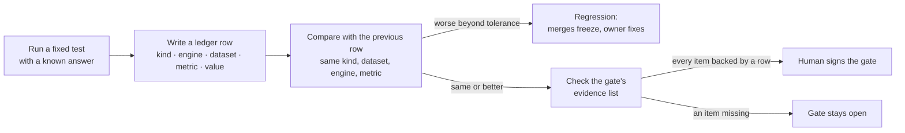

# How Benchmarking Works

*Last updated: 2026-10-17 (T107 blind A/B session tool added; T073 synthetic-v1 set and recovery harness added; T066b parity probes added; T066c flanger and phaser closed). Kept current by `benchmark` whenever a test, a threshold, a gate or a verdict changes, and checked by the lead at every `plan-sync`.*

The benchmark is the project's referee. It does not build or tune anything. It runs fixed tests with known answers, records every result as a row in the ledger, compares each result with the previous one, and ticks a gate only when the ledger shows the gate's evidence. Today it can tell us that the two engines work and agree with each other. It cannot yet tell us whether a match is good, because the test that answers that (the Helix synthetic set) has not been rendered.

One command runs every test in a fixed order, times each one, and records the run: `python scripts/benchmark_suite.py`. The section below, between the `latest-run` markers, is regenerated from that run and shows the results and run times of the most recent one. `python scripts/benchmark_suite.py --render-doc` refreshes only that section.

<!-- latest-run:start -->
<!-- Generated by scripts/benchmark_suite.py --render-doc from reports/benchmark/latest.json. Do not edit by hand. -->

### Most recent benchmark run

- **Run:** 2026-10-15 21:34 UTC, commit `3829a89-dirty`
- **Machine:** macOS 27.0.1 (arm64, 10 cores, 32 GB); Helix Native 3.82; HX Stomp firmware 3.50
- **Total run time:** 5 min 48 s (348 s), the sum of the test run times below. Skipped and not-available tests count as 0 s.
- **Outcome:** 6 pass, 1 fail, 2 not available.
- **Suite ledger row:** [2026-10-15T21:40:38+00:00](../ledger/runs.csv?plain=1#L214 "benchmark · - · suite · suite_wall_clock_s = 348.25") (`benchmark`, dataset `suite`, metric `suite_wall_clock_s`).

- **Against the previous run:** This is the first recorded run, so there is nothing to compare with yet.

| Test | Status | Key result, and what it means | Pass rule | Run time | Ledger rows |
| --- | --- | --- | --- | --- | --- |
| **Engine smoke, Helix Native** — Native loads a known preset and renders a 2 s clean guitar clip | pass | renders cleanly: peak -13.8 dBFS, 0.17 s per render | length right, no invalid values, peak between -30 and -1 dBFS, at least 20 dB above the noise floor | 7 s | [2026-10-15T21:34:57+00:00](../ledger/runs.csv?plain=1#L185 "smoke · native · smoke · peak_dbfs = -13.82 (first of 2 rows at this time)") (2 rows) |
| **Engine smoke, HX Stomp** — The pedal loads the same preset, renders the clip, and is put back on its own preset | pass | renders cleanly: peak -13.5 dBFS, 2.66 s per render | same checks as Native, health check passes, original preset restored | 13 s | [2026-10-15T21:35:09+00:00](../ledger/runs.csv?plain=1#L187 "smoke · stomp · smoke · peak_dbfs = -13.54 (first of 2 rows at this time)") (2 rows) |
| **Hardware parity (null test)** — Same clean guitar clip and presets K, A, B0, B00 and BT0 through the Stomp and Native, aligned, level-matched and subtracted | pass | null (dB, lower is closer): K -31.0, A -30.9, B0 -37.1, B00 -39.7; delay-tail level, Stomp minus Native +1.3 dB; pedal restored byte for byte | null at or below -30 dB for K, A, B0 and B00; delay tail (BT0) level within 2 dB; 04C restored and byte-diffed | 2 min 22 s | [2026-10-15T21:37:31+00:00](../ledger/runs.csv?plain=1#L194 "parity · both · parity-v0 · null_residual_db = -30.97 (first of 8 rows at this time)") (8 rows), [21:37:32](../ledger/runs.csv?plain=1#L202 "parity · both · parity-v0 · null_residual_db = -16.1 (first of 3 rows at this time)") (3 rows) |
| **Loss trust check (proxy)** — Does each scoring method rank the true setup first among 15 decoys? On stand-in digital effects, not Helix, because the Helix set is not rendered | pass | best held-out rank-1 0.28 (provisional_sum) over 40 items; chance 0.062; combined score 0.28 vs the 0.95 needed on real Helix audio: not trusted yet | no method's held-out rank-1 falls more than 0.05 below the previous run (seeds 9301, 9302); the 0.90 / 0.95 admission rule needs Helix audio | 87 s | [2026-10-15T21:38:58+00:00](../ledger/runs.csv?plain=1#L205 "loss-trust · - · proxy-dsp-v0 · rank1_rate = 0.15 (first of 4 rows at this time)") (4 rows), [21:38:59](../ledger/runs.csv?plain=1#L209 "loss-trust · - · proxy-dsp-v0 · rank1_rate = 0.1 (first of 4 rows at this time)") (4 rows) |
| **Synthetic recovery (CI subset)** — Can the matcher recover known presets from their sound? | not available | Why: not available: the synthetic set has labels only (180 labelled items) and no rendered audio yet | the [Gate 2](../board/GATES.md#gate-2--recovers-known-presets-end-of-week-3 "Gate 2 — recovers known presets (end of week 3)") targets in [docs/BENCHMARKING.md](../docs/BENCHMARKING.md "How Benchmarking Works") | 0 s | none |
| **Separation stress** — How fast does accuracy fall as the mix gets denser? | not available | Why: not available: the synthetic set has labels only (180 labelled items) and no rendered audio yet | recorded as a curve, not gated | 0 s | none |
| **Block-probe validate (synthetic)** — Does the probe analysis measure known synthetic blocks correctly? | pass | 63 of 63 checks within tolerance on 14 known synthetic blocks | every check within its tolerance | 8 s | [2026-10-15T21:39:07+00:00](../ledger/runs.csv?plain=1#L213 "smoke · - · probe-synth-v1 · probe_checks_pass_rate = 1.0") |
| **Offline unit tests (pytest -q)** — The repository's offline tests | **FAIL** | 401 tests passed, 1 failed, 1 skipped Problem: ..."], -- Docs: https://docs.pytest.org/en/stable/how-to/capture-warnings.html =========================== short test summary info ============================ FAILED [tests/test_task_links.py::test_real_docs_are_linked](../tests/test_task_links.py?plain=1#L121 "test_real_docs_are_linked") - AssertionError: ... 1 failed, 401 passed, 1 skipped, 1 warning in 90.33s (0:01:30) | no test fails | 1 min 31 s | none |
| **Lint (ruff)** — Style and simple bug checks on src, tests and scripts | pass | no lint problems in src, tests and scripts | no findings | under 1 s | none |

How to read it: *pass* means the test's rule was met; *fail* means it was not (a fail that was a pass last time is a regression); *skipped* means we chose not to run it or could not, for the reason shown (for example no pedal); *not available* means what the test needs does not exist yet. Neither of the last two is a pass or a failure. A null in dB is how much of the signal is left after subtracting the two outputs; lower is closer. Rank-1 is how often a scoring method put the true setup first; higher is better. Run time is wall-clock seconds on the machine above. The data is in [`reports/benchmark/latest.json`](../reports/benchmark/latest.json "reports/benchmark/latest.json"), and every earlier run in `reports/benchmark/history/`.
<!-- latest-run:end -->

## Time per sample

How long one unit of each activity takes, on each engine, and what a typical run of them adds up to. Regenerated from the ledger by `python scripts/engine_timing.py --render-doc` (the status report refreshes it on every run), so new ledger rows show up without anyone editing the table.

<!-- time-per-sample:start -->
<!-- Generated by scripts/engine_timing.py --render-doc from ledger/runs.csv. Do not edit by hand. -->

Every figure below is read from a ledger row (the link on each figure opens it). A "sample" is one unit of the activity. **Total** is the typical count times the time per sample: it is computed, not measured. Where the ledger has no measurement the cell says "not measured"; nothing is estimated to fill a gap. Native pool figures are throughput at the 6-host cap (1 divided by tests per second), and a Native test is a render plus its score; a Stomp render is the render only, so the two are different units and are not subtracted from each other. Pedal figures are on firmware 3.80.

| Activity | One sample is | Native, per sample | Stomp, per sample | No engine, per sample | Typical count | Total |
|---|---|---|---|---|---|---|
| Native test, 2 s clip, 6 hosts | one test = one render of a 2 s clip (+ 3 s pre-roll) and its score, pool of 6 hosts, throughput | 0.10 s ([row 294](../ledger/runs.csv?plain=1#L294 "2026-10-16 00:38 · render-cost · native · smoke · renders_per_s = 9.879")); 9.879 tests per second | not the same unit: the pedal render is below | - | 39 (renders in one search run; [row 381](../ledger/runs.csv?plain=1#L381 "2026-10-16 03:41 · search · native · ds-sample-intro-cliplen · seconds_per_trial_full = 8.3")) | Native 3.95 s |
| Native test, 2 s clip, 1 host | one test = one render of a 2 s clip (+ 3 s pre-roll) and its score, one host | 0.59 s ([row 276](../ledger/runs.csv?plain=1#L276 "2026-10-16 00:25 · render-cost · native · smoke · renders_per_s = 1.703")); 1.703 tests per second | not the same unit: the pedal render is below | - | 39 (renders in one search run; [row 381](../ledger/runs.csv?plain=1#L381 "2026-10-16 03:41 · search · native · ds-sample-intro-cliplen · seconds_per_trial_full = 8.3")) | Native 22.9 s |
| Native test, 10 s clip, 6 hosts | one test = one render of a 10 s clip (+ 3 s pre-roll) and its score, pool of 6 hosts, throughput | 0.22 s ([row 295](../ledger/runs.csv?plain=1#L295 "2026-10-16 00:38 · render-cost · native · smoke · renders_per_s = 4.639")); 4.639 tests per second | not the same unit: the pedal render is below | - | 39 (renders in one search run; [row 381](../ledger/runs.csv?plain=1#L381 "2026-10-16 03:41 · search · native · ds-sample-intro-cliplen · seconds_per_trial_full = 8.3")) | Native 8.41 s |
| Native test, 10 s clip, 1 host | one test = one render of a 10 s clip (+ 3 s pre-roll) and its score, one host | 1.24 s ([row 276](../ledger/runs.csv?plain=1#L276 "2026-10-16 00:25 · render-cost · native · smoke · renders_per_s = 1.703")); 0.806 tests per second | not the same unit: the pedal render is below | - | 39 (renders in one search run; [row 381](../ledger/runs.csv?plain=1#L381 "2026-10-16 03:41 · search · native · ds-sample-intro-cliplen · seconds_per_trial_full = 8.3")) | Native 48.4 s |
| Search run (ds-sample-intro-cliplen), full 7.5 s excerpt per trial | one trial (render + score) in a search over the DS-Sample intro, run wall clock divided by renders | 0.85 s ([row 381](../ledger/runs.csv?plain=1#L381 "2026-10-16 03:41 · search · native · ds-sample-intro-cliplen · seconds_per_trial_full = 8.3")); 33.0 s wall clock over 39 renders, host start included | 8.40 s ([row 312](../ledger/runs.csv?plain=1#L312 "2026-10-16 02:26 · render-cost · stomp · ds-sample-intro · seconds_per_trial_legacy = 8.4")); pedal run with the old 7.5 s clip, readback on every load | - | 39 (renders in one search run; [row 381](../ledger/runs.csv?plain=1#L381 "2026-10-16 03:41 · search · native · ds-sample-intro-cliplen · seconds_per_trial_full = 8.3")) | Native 33.0 s; Stomp 5.5 min |
| Search run (ds-sample-intro-cliplen), loudest 3 s clip per trial | the same, searching on the loudest 3 s of the excerpt | 0.64 s ([row 383](../ledger/runs.csv?plain=1#L383 "2026-10-16 03:42 · search · native · ds-sample-intro-cliplen · seconds_per_trial_loudest3 = 3.8")); 25.0 s wall clock over 39 renders | 3.80 s ([row 313](../ledger/runs.csv?plain=1#L313 "2026-10-16 02:26 · render-cost · stomp · ds-sample-intro · seconds_per_trial_default = 3.8")); pedal default (3 s clip, readback every 10, measured tails), 2.8 min over 39 renders | - | 39 (renders in one search run; [row 381](../ledger/runs.csv?plain=1#L381 "2026-10-16 03:41 · search · native · ds-sample-intro-cliplen · seconds_per_trial_full = 8.3")) | Native 25.0 s; Stomp 2.5 min |
| Template capture per model (block-library-v1) | one Stomp model captured once into a Native template (the pedal takes the model directly) | 0.56 s ([row 473](../ledger/runs.csv?plain=1#L473 "2026-10-16 15:25 · render-cost · native · block-library-v1 · capture_per_chain_s = 0.563")); 3 parallel sessions, every control checked | not needed: the pedal takes the model directly | - | 605 (models in the library; [row 473](../ledger/runs.csv?plain=1#L473 "2026-10-16 15:25 · render-cost · native · block-library-v1 · capture_per_chain_s = 0.563")) | Native 5.7 min |
| Separation per mix (sep-stress-v1) | one 20 s mix split into stems (no engine involved) | no engine | no engine | 3.10 s ([row 469](../ledger/runs.csv?plain=1#L469 "2026-10-16 15:22 · stress · - · sep-stress-v1 · seconds_per_mix = 3.09636")); mean of the run; machine learning model on the Mac GPU | 39 (mixes in the stress set; [row 469](../ledger/runs.csv?plain=1#L469 "2026-10-16 15:22 · stress · - · sep-stress-v1 · seconds_per_mix = 3.09636")) | 2.0 min |
| Stomp render, 2 s clip (clip + about 0.67 s) | one 2 s test clip played through a preset on the pedal and recorded (fw 3.80) | 0.17 s ([row 839](../ledger/runs.csv?plain=1#L839 "2026-10-17 17:39 · render-cost · native · smoke-real-di · seconds_per_render = 0.1677")); render alone | 2.69 s ([row 242](../ledger/runs.csv?plain=1#L242 "2026-10-15 23:48 · render-cost · stomp · stomp-speed · seconds_per_render_clip2s = 2.6889")); median of 3 | - | 39 (renders in one default search run on the pedal; [row 313](../ledger/runs.csv?plain=1#L313 "2026-10-16 02:26 · render-cost · stomp · ds-sample-intro · seconds_per_trial_default = 3.8")) | Stomp 1.7 min |
| Stomp render, 3 s clip (clip + about 0.67 s) | one 3 s test clip played through a preset on the pedal and recorded (fw 3.80) | not measured (render alone not measured for this clip length) | 3.67 s ([row 243](../ledger/runs.csv?plain=1#L243 "2026-10-15 23:48 · render-cost · stomp · stomp-speed · seconds_per_render_clip3s = 3.6659")); median of 3 | - | 39 (renders in one default search run on the pedal; [row 313](../ledger/runs.csv?plain=1#L313 "2026-10-16 02:26 · render-cost · stomp · ds-sample-intro · seconds_per_trial_default = 3.8")) | Stomp 2.4 min |
| Stomp render, 4 s clip (clip + about 0.67 s) | one 4 s test clip played through a preset on the pedal and recorded (fw 3.80) | not measured (render alone not measured for this clip length) | 4.66 s ([row 244](../ledger/runs.csv?plain=1#L244 "2026-10-15 23:48 · render-cost · stomp · stomp-speed · seconds_per_render_clip4s = 4.6619")); median of 3 | - | 39 (renders in one default search run on the pedal; [row 313](../ledger/runs.csv?plain=1#L313 "2026-10-16 02:26 · render-cost · stomp · ds-sample-intro · seconds_per_trial_default = 3.8")) | Stomp 3.0 min |
| Stomp render, 10 s clip (clip + about 0.67 s) | one 10 s test clip played through a preset on the pedal and recorded (fw 3.80) | 2.25 s ([row 46](../ledger/runs.csv?plain=1#L46 "2026-10-14 21:02 · render-cost · native · smoke · seconds_per_10s_render = 2.2488")); render alone, older flow that reset the engine every render | 10.7 s ([row 245](../ledger/runs.csv?plain=1#L245 "2026-10-15 23:48 · render-cost · stomp · stomp-speed · seconds_per_render_clip10s = 10.6708")); median of 3 | - | 39 (renders in one default search run on the pedal; [row 313](../ledger/runs.csv?plain=1#L313 "2026-10-16 02:26 · render-cost · stomp · ds-sample-intro · seconds_per_trial_default = 3.8")) | Stomp 6.9 min |
| Stomp search trial (3 s clip, speed options) | one candidate: parameters changed in place, rendered on the pedal, render side only (no score) | see the Native test and search-run rows | 3.76 s ([row 275](../ledger/runs.csv?plain=1#L275 "2026-10-16 00:17 · render-cost · stomp · stomp-speed · search_batch_per_trial_s_after = 3.7649")); readback every 10 loads, measured tails | - | 32 (trials in the search stage of one default run; [row 313](../ledger/runs.csv?plain=1#L313 "2026-10-16 02:26 · render-cost · stomp · ds-sample-intro · seconds_per_trial_default = 3.8")) | Stomp 2.0 min |
| Stomp search trial (10 s clip, before the speed options) | the same with a 10 s clip, readback on every load, worst-case tails | see the Native test and search-run rows | 10.9 s ([row 274](../ledger/runs.csv?plain=1#L274 "2026-10-16 00:17 · render-cost · stomp · stomp-speed · search_batch_per_trial_s_before = 10.861")); for comparison with the row above | - | 32 (trials in the search stage of one default run; [row 313](../ledger/runs.csv?plain=1#L313 "2026-10-16 02:26 · render-cost · stomp · ds-sample-intro · seconds_per_trial_default = 3.8")) | Stomp 5.8 min |
| Verify one finalist on the pedal | one finalist written whole to the pedal and rendered twice on 10 s clips (one session) | verification runs on the pedal | 24.7 s ([row 273](../ledger/runs.csv?plain=1#L273 "2026-10-16 00:10 · render-cost · stomp · stomp-speed · verify_batch_per_finalist_s_after = 24.6507")) | - | 3 (finalists verified per song section (the status report's verify_top3 job, a design choice, not a ledger count)) | Stomp 74.0 s |
| Preset load | one generated preset loaded: written whole to the pedal, or a stored template loaded into Native | 0.15 s ([row 72](../ledger/runs.csv?plain=1#L72 "2026-10-14 23:40 · render-cost · native · smoke · hc_mode_switch_load_s = 7.2")); same mode; a mode change reloads the engine, 7.20 s | 0.53 s ([row 238](../ledger/runs.csv?plain=1#L238 "2026-10-15 23:40 · render-cost · stomp · fw380-write · whole_preset_write_s = 0.289")); whole load(); the write alone is 0.29 s | - | not recorded | no typical count recorded |
| Session overhead | opening the pedal engine, restoring the original preset and byte-checking it, paid once per batch | no pedal session | 0.77 s ([row 241](../ledger/runs.csv?plain=1#L241 "2026-10-15 23:47 · render-cost · stomp · stomp-speed · session_overhead_per_test_new_s = 0.7716")); once per batch | - | 1 (once per batch (one engine for the whole batch); [row 241](../ledger/runs.csv?plain=1#L241 "2026-10-15 23:47 · render-cost · stomp · stomp-speed · session_overhead_per_test_new_s = 0.7716")) | Stomp 0.77 s |
| Two-path pass on the Stomp (twopath-parity-fw380) | one pass renders both paths at once, so one pass gives two renders (Path A on USB 1/2, Path B on USB 3/4) | the pedal only | not measured (the whole comparison (2 single-path renders + 2 two-path passes = 4 renders) took 26.4 s, 6.60 s per render with the preset writes and session included; a pass alone is not timed) | - | 2 (renders per pass; [row 635](../ledger/runs.csv?plain=1#L635 "2026-10-16 15:50 · parity · stomp · twopath-parity-fw380 · null_residual_db = -63.9")) | not measured |
| Parity spot check per model (parity-spot-fw380) | one preset rendered on both engines, then the two recordings aligned and compared | not measured (no wall clock recorded in the ledger) | not measured (no wall clock recorded in the ledger) | - | 47 (presets compared in the spot check; [row 316](../ledger/runs.csv?plain=1#L316 "2026-10-16 02:31 · parity · both · parity-spot-fw380 · null_residual_db = -30.87")) | not measured |
| Score one candidate (helix-trust-v1) | one rendered candidate compared with the target (candidate features and distance, target cached) | included in the Native test rows | not measured on the pedal side | 0.05 s ([row 627](../ledger/runs.csv?plain=1#L627 "2026-10-16 15:50 · loss-trust · native · helix-trust-v1 · seconds_per_test = 0.007638"), [row 628](../ledger/runs.csv?plain=1#L628 "2026-10-16 15:50 · loss-trust · native · helix-trust-v1 · seconds_per_test = 0.03427"), [row 629](../ledger/runs.csv?plain=1#L629 "2026-10-16 15:50 · loss-trust · native · helix-trust-v1 · seconds_per_test = 0.01158")); three signal-processing terms added, render excluded; not included: mrstft 0.12 s ([row 739](../ledger/runs.csv?plain=1#L739 "2026-10-17 00:29 · loss-trust · native · helix-trust-v2 · seconds_per_test = 0.1155")), embed_afxrep 0.11 s ([row 631](../ledger/runs.csv?plain=1#L631 "2026-10-16 15:50 · loss-trust · native · helix-trust-v1 · seconds_per_test = 0.1113")) | not recorded | no typical count recorded |

<!-- time-per-sample:end -->

## What it decides, and on what evidence

Three rules govern every conclusion:

1. **A claim without a ledger row did not happen.** Every result is one row in [`ledger/runs.csv`](../ledger/runs.csv): when, which commit, which agent, what kind of test, which engine, which dataset, which metric, the value, and notes. Rows are only ever appended. A wrong row is corrected by a new row, and accidental rows are listed in [`ledger/void.csv`](../ledger/void.csv) and skipped.
2. **Better or worse is always relative to the previous row of the same test.** A comparison only counts when the kind, dataset, engine and metric all match. A drop beyond the tolerance is a regression, and merges freeze until it is fixed.
3. **The ear is the final judge.** The benchmark prepares listening sessions but never scores them. Only the human's ratings decide whether a match is good.

## The tests

| Test | What it answers | How it reaches a result | Pass rule | State today |
| --- | --- | --- | --- | --- |
| **Engine smoke** | Does an engine render at all? | Load a known preset, render a 2-second clean guitar clip, check length, no invalid values, a sensible level, and a clear gap above the noise floor. On the Stomp it also checks the pedal was put back on its original preset. | Every check passes | Passing on both engines; part of the suite |
| **Hardware parity (null test)** | Does the HX Stomp play a preset the same way as Native? | The same clean guitar recording and the same preset go through both. The two outputs are aligned to a fraction of a sample, level-matched with one gain, and subtracted. What is left, relative to the signal, is the "null" in dB; lower means closer. Also reported per octave band and over delay tails. | About -30 dB or lower (the level at which the pedal repeats itself) | Run on several presets; K, A, B0 and the delay-tail pair B00 and BT0 are in the suite; see below |
| **Synthetic recovery** | Can the matcher find a preset when we know the right answer? | 96 test items (T073, `synthetic-v1`): known one-block presets from the Native block library, 12 in each of 8 categories (drive, delay, reverb, dynamics, EQ, modulation, amp, cab), settings on Native's control grid, rendered on Native through clean guitar clips. The matcher is given only the sound and a pool of 47 candidate models; it must name the category, the model and the settings. Scored on category (block F1), model, setting error, and whether the true preset beats 24 neighbours on new notes. | The Gate 2 targets below | Set built and harness tested end to end on 3 items; the full 96-item run waits on admitted loss weights (see "Synthetic recovery set" below). In the suite it runs an 8-item subset, marked provisional |
| **Separation stress** | How fast does accuracy fall as the mix gets denser? | The same items mixed with other instruments at increasing levels, then separated, then matched. | Recorded as a curve, not gated | Shown as "not available" in the suite until the set has rendered audio |
| **Trust check for a comparison method** | Does a scoring method rank the right preset first? | For each known preset, the true answer and 15 decoys (7 close, 8 random) are scored; the method passes if the true one comes first. Run by `tone-metrics`, with the threshold set by the benchmark. | 0.90 per method, 0.95 for the combined score | Only on stand-in signals so far; best combined about 0.3. The suite runs it in proxy mode on fixed seeds 9301 and 9302 and flags a drop of more than 0.05 against the previous run; the 0.90 / 0.95 rule waits for Helix audio |
| **Block-probe validate** | Does the probe analysis measure blocks whose answer we know? | Known digital blocks (not Helix) are run through the probe and each measured feature is compared with the truth. | Every check within its tolerance | Part of the suite |
| **Unit tests and lint** | Does the code still do what its tests say, and is it tidy? | `pytest -q` and `ruff check`, offline. | No test fails; no lint finding | Part of the suite |
| **Engine comparison** | How much quality does the slower hardware path cost? | The same songs matched on Native and on the Stomp. | Recorded, not gated | Not run |
| **Blind listening (A/B)** | Does a person prefer the match? | Clips are trimmed, level-matched, randomised and given hidden labels; the answer key is kept apart. The human rates them; the benchmark joins ratings and key. | Preferred over the nearest community preset on most songs (Gate 3) | Two informal, non-blind verdicts recorded. The session tool `scripts/ab_session.py` is built (T107) and untried by a listener |

### Running a blind listening session (T107)

`scripts/ab_session.py` prepares the session and records the human's answers. It never judges the audio. It needs no Native and no pedal.

1. **Build.** `python scripts/ab_session.py build --name gate3-a --pair "song1=ours.wav,stock.wav" --pair ... [--abx 3] [--excerpt-s 8] [--seed N]`. In each pair the first file (X) is what is being tested (our match or the recovered preset) and the second (Y) is what it is compared with (the target or the nearest stock preset). Each pair is cut to one shared excerpt (the loudest stretch, short fades), both clips are set to -23 LUFS (if either would clip, both are lowered together so they stay matched), and a seeded random draw decides which one plays as A. Clips get random file names.
2. **Listen.** Open `reports/local/ab/<name>/index.html` in a browser (works from a file, no network). For each pair press A better, B better or Same, optionally set the confidence slider and write notes. Answers save in the browser as you go. The hidden key is `reports/local/ab/<name>.key.json`, outside the page folder; do not open it until you finish. The optional ABX trials play A, B and an unknown X and ask which one X matches.
3. **Export.** Press "Copy answers as JSON" and save the text as a file.
4. **Score.** `python scripts/ab_session.py score --key reports/local/ab/<name>.key.json --answers answers.json`. It prints the choice per pair, the share of decided pairs where X was chosen with an exact two-sided binomial p-value (ties are left out of the test and counted), and ABX accuracy. It writes ledger rows `kind=ab`, dataset `ab-<name>`, metrics `ab_pref`, `ab_binom_p`, `abx_acc` (`--no-ledger` skips them). Gate 3 wants X preferred over the nearest community preset on most songs; the benchmark ticks it only from these rows plus the listener's sign-off.
5. **Gate 2 demo.** `python scripts/ab_session.py gate2-demo` builds about 6 pairs (recovered vs target) from synthetic-v1 run outputs. Today those runs saved no audio (only JSON and logs), so it prints what to save after the Gate 2 run: `<item>_target.wav` and `<item>_recovered.wav` under a run directory. Nothing was rendered for this tool.

Session files stay under `reports/local/` (gitignored); no song audio leaves the machine.

### Hardware parity results so far

| Preset | Null | What it means |
| --- | --- | --- |
| Smoke chain, more-drive variant, Plexi variant (no delay) | -30.4 to -37.5 dB | Same sound on both |
| Song match with the cab's Early Reflections at 0 | -30.5 and -31.4 dB | Same sound on both |
| Song match with Early Reflections at 0.783 | -3.6 dB | Different: this setting behaves differently on firmware 3.50 than in Native 3.82, so it is held at 0 for anything bound for the pedal |
| Delay tails, fixed delay time | +4.3 dB over the tail | Echoes are equally loud but Native's arrive about 0.8% later (Native's 63 ms step in delay time, not an engine difference, T066b), so delay tails cannot null across engines; judge delays by level and time, not by null |
| Rendering two chains at once on the Stomp's two paths | -18 to -22 dB against single-path renders (before the layout fix); -72.9 dB after it | The gap was a bug in how two-path presets were written; two-path passes may be used again (lead, 2026-10-16). The spot checks below used single-path renders only |

### Parity spot checks by block type (T060, firmware 3.80, 2026-10-16)

At least five models per block category, each rendered on the Stomp (fw 3.80) and on Native 3.82 from the same `.hlx` and the same clip (4 s of guitar and 2 s of silence), Hum and Ripple at 0, cab Early Reflections at 0. Passing means a null of -30 dB or lower; delays are judged by echo level (within 2 dB) and echo timing. Dataset `parity-spot-fw380`, rows from 2026-10-16T02:31 in the ledger. Two pedal sessions, single-path only.

| Category | Models | Null at -30 dB or lower | Median null | Note |
| --- | --- | --- | --- | --- |
| Distortion | 5 | 2 | -28.6 dB | Scream 808, Kinky Boost pass; Heavy Dist -25.7, Triangle Fuzz -28.6, Bitcrusher -27.4 miss by 1 to 5 dB |
| Delay | 5 | echo level 5 of 5 | -7.0 dB (not a criterion) | Level within 0.5 dB; Native later by ~2.96 ms per echo (+0.79%) on four models, earlier by ~2.1 ms on Adriatic; both are Native's 63 ms delay-time step (T066b) |
| Reverb | 6 | 0 | -15.4 dB | -5.9 (Ganymede) to -22.8 ('63 Spring); the pedal repeats itself at -77.7 dB (Room) |
| Dynamics | 6 | 6 | -36.9 dB | |
| EQ | 5 | 5 | -32.5 dB | |
| Modulation | 6 | 0 | -2.2 dB | The pedal's repeat floor is -1.5 dB (free-running LFO), so a null cannot be used for modulation |
| Amp | 5 | 5 | -41.0 dB | |
| Cab | 5 | 5 | -35.6 dB | |

Cab Early Reflections on 3.80 (K's Blue Bell, ER 0 / 0.25 / 0.5 / 1.0): -28.1 / -12.1 / -6.6 / -1.0 dB. Unchanged from 3.50; the freeze at 0 stays. The first pass refused eight files because the Stomp's block lacks Helix-only parameters (Scale, Spread, Stereo); those files were regenerated without them and passed readback.

### Parity probes with purpose-made signals (T066b, firmware 3.80, 2026-10-16)

One pedal session (13 presets, 48 renders, 477 s; the pedal was left on its original preset, read back and byte-equal) and one Native batch (26 renders). Stimuli: noise burst plus 6 s of silence (reverb), 10 s sines at 330 Hz and 1 kHz and a real guitar note (modulation), the click burst for Simple Delay at 600 ms. Every model twice on the Stomp (repeat floor), once on Native. Dataset `parity-timefx-stimuli-fw380`, 119 ledger rows from 2026-10-16T15:36:2x; script `scripts/parity_timefx_stimuli.py`, measurement `src/tonematch/metrics/sine_mod.py`. Tolerances are the lead-accepted T066 ones; a difference counts only beyond the measurement floor.

| Category | Models | No check outside tolerance | Within tolerance on every check | Outside | Unresolved |
| --- | --- | --- | --- | --- | --- |
| Reverb | 6 | 4 | 0 | Hall (RT60 at 250 Hz, -8.2 %), Ganymede (RT60 at 500 Hz, 1 kHz, 4 kHz: -11.0, -11.4, +5.7 %) | EDT, tail spectrum and tail level on all six (floors larger than the tolerances); low-octave RT60 on most |
| Modulation | 5 | 5 | 3 (70s Chorus, Bubble Vibrato, MM4 Chorus) | none | Gray Flanger and Deluxe Phaser: 1.5 and 1.9 LFO cycles in 10 s, under the 2 required |
| Delay at 600 ms | 1 | after the grid correction | | raw +4.99 % | |

Key finding: **Native applies every knob through a 128-step control over the catalog range**, so delay Time moves in 62.99 ms steps (0 to 8 s) and rates in Hz in similar steps; the Stomp takes the exact value. The "Native +0.79 % late" of T060/T066 was this, not the engine (Native 629.92 ms for a 600 ms request, nothing else; the Stomp 600.0002 ms). The 1.0079 export scaling is therefore proposed for rejection (DECISIONS, T066b). Phaser rate +18.1 % and MM4 rate -3.4 % are the same effect (predicted +18.11 % and -3.43 %). Details and rulings proposed to the lead: `docs/DECISIONS.md`, 2026-10-16 (benchmark, T066b).

**Parity method rule (lead ruling on T066b, implemented in T066c).** Before any parity script renders on the Stomp it writes Native's stepped values into the Stomp file (`scripts/parity_snap.py`: `cc_value(lo, hi, round(norm x 127))`, with lo and hi read from the captured Native template, which T072 narrows, never from the catalog). `parity_spot.py` and `parity_timefx_stimuli.py` do this on their own and refuse to run when no template exists; `parity_timefx.py` lists which Stomp renders were made on requested values (the T060 ones) so a stepping artefact is not read as an engine difference. Earlier rows are noted, not voided. Result of the 20 s sine session for Gray Flanger and Deluxe Phaser (T066c, one pedal session, 3 presets, 211 s, 04C restored and byte-equal): both within tolerance. Flanger rate 0.163 Hz on both (3.1 cycles), level swing within 0.1 dB; Phaser rate 0.236 Hz on both (4.6 cycles), level swing within 0.45 dB, mean gain within 0.9 dB. Both engines used the pre-T072 spot380 template ranges (not block-library-v1.1). 21 rows `parity-timefx-stimuli-fw380` (notes `task=T066c`), 2026-10-16T16:18:35. Proposal to the lead in DECISIONS: Native may stand in for both. In the T066b table above, Modulation Gray Flanger and Deluxe Phaser move from unresolved to within tolerance.

### Synthetic recovery set (`synthetic-v1`, T073, 2026-10-16)

What it is. 96 known presets, each one block taken from the Native block library (one captured block per model), so one item is one category, one model and its settings. Twelve items in each of eight categories: drive, delay, reverb, dynamics, EQ, modulation, amp, cab. The "other" category (wahs, pitch, synths, volume) is left out because no ruling says Native stands in for it. Also left out: the three blocks whose Native render is not repeatable, Bitcrusher drives, reverbs other than Room, Plate, '63 Spring, Chamber and Hall, and modulation other than tremolo, 70s Chorus, Bubble Vibrato and MM4 Analog Chorus (the lead's stand-in list of 2026-10-16). Settings sit on Native's 128-step control grid, within each template's own range (so the narrowed delay and rate ranges apply), drawn between 0.10 and 0.90 of the range. Level, channel volume, compressor make-up gain, Hum, Ripple and cab early reflections are not varied. The guitar is a 10 s Guitar-TECHS excerpt (clip A); clip C is another passage of the same recording, used as "new notes". No song audio.

How the search is run. The matcher may choose from a pool of 47 models (a seeded sample of up to 6 per category; every true model is in the pool, so the chance of naming the model is 1 in 5 to 1 in 6). One fixed budget per item (150 renders by default): every pool model is rendered once at its catalog settings, then the best 3 are tuned with the remaining renders. The target is the true preset rendered on clip A, an isolated oracle, so this test measures the search and the scoring method, not the separator.

What is scored.

| Measure | How it is counted | Chance |
| --- | --- | --- |
| Block F1 | The block category the best match belongs to, against the true category. With one block per item this is identification accuracy (F1 of "this category is on") | 1 in 8 |
| Model accuracy | The best match is exactly the true model | 0.18 on average |
| Setting error | Mean absolute error of each setting, as a fraction of its range, on items whose model was right | 0.19 to 0.25 for "always the middle" |
| True preset first | The true preset is scored on the new notes (clip C) against its target (the true preset on clip A) together with 24 neighbours (9 with 1 to 2 knobs moved by 0.12 to 0.30 of their range, 5 other models of the same category, the rest random other categories). It must score strictly better than all 24. Also reported without neighbours that null against the truth at -30 dB or below (same sound) | 1 in 25 |
| Held-out loss | Loss of the match on clip C against the true preset on clip C, and its ratio to the loss on clip A (target 1.25 or less) | - |

Weights. The scoring method's weights are a parameter (`--weights`, default `PROVISIONAL_WEIGHTS`, the three no-DI terms at weight 1). Nothing is admitted yet (`tone-metrics`, helix-trust-v1), so every run is labelled "provisional, not gate evidence" in its ledger notes and summary, and its metric rows are not Gate 2 evidence. A run of fewer than all 96 items is written under dataset `synthetic-v1-n<k>` so it never becomes the baseline of the full set. The rows from the 3-item test are under `synthetic-v1-n3`.

First end-to-end result (3 items, drive, delay, reverb, one Native host, provisional weights, not gate evidence): category right 2 of 3, model right 0 of 3, true preset first 0 of 3 on new notes (it ranked 5th, 7th and 2nd among 25), held-out loss 7.48 against 4.06 on the fit notes (ratio 1.84). The true model sat 4th, 23rd and 15th of 47 in the first pass. This agrees with the T067 finding that the no-DI terms cannot tell neighbouring models or note changes apart; with the true settings the loss on clip A is exactly 0, so the shortfall is the scoring method and the search budget, not the render. Three items say nothing about the rates; they test the harness.

Cost. One item took 59 to 63 s on one host: about 190 renders of 10 s clips (47 first-pass, about 115 tuning, 24 neighbours, the rest targets and the final check) at 0.31 s each including scoring. The full 96 items take about 1.6 h on one host (estimated from 3 items); the suite's 8-item subset about 8 min. Items are independent, so `--shard k/n` splits a run over n processes with one host each (the machine limit is 6 native_host processes).

Run it: `python scripts/synthetic_v1.py generate` (offline, writes `cache/synthetic-v1/` and `fixtures/synthetic/manifest.json`, which has no model ids), then `python scripts/synthetic_v1.py run [--items N] [--budget R] [--weights file] [--shard k/n] --ledger`. Wired into the suite as "Synthetic recovery (CI subset)".

What it still waits on: admitted loss weights from `tone-metrics` (pass `--weights` with the admitted file; until then nothing it measures is gate evidence); frozen Gate 2 thresholds; the two baselines at the same budget ("middle of every knob" and a random search) before the thresholds can freeze; and the human's sign-off. The density-stress variant (mix stems) is not built; the separation curve is recorded separately as `sep-stress-v1`.

### The three synthetic sets and their roles (T130, 2026-10-17)

All three come from the same generator (`scripts/synthetic_v1.py generate --set NAME`; each lives in `cache/NAME/` and its dataset name is NAME). Same rules as above: one Native block per item, settings on the control grid drawn between 0.10 and 0.90 of the range, a seeded pool of up to 6 models per category (every true model is in the pool), 24 neighbours, 10 s Guitar-TECHS excerpts.

| Set | Seed | Items | Role |
| --- | --- | --- | --- |
| `synthetic-v1` | 20261016 | 96 (12 x 8 categories) | Gate 2 attempt 1. Now seen: it was run and its results studied. Not a test set any more. |
| `synthetic-devfam` | 20261018 | 96 (24 each of mod, reverb, delay, amp) | Tuning set for the per-family specialists. Specialists may tune freely on it. |
| `synthetic-v2` | 20261019 | 96 (12 x 8 categories) | **SPENT.** Sealed test set of Gate 2 attempt 2 (6 of 7 checks, not passed). Its runs `gate2_v2_attempt2`, `v2_base_middle` and `v2_base_random` are SPENT: they are the attempt-2 evidence and are never re-run for a claim. The set is now seen and is no longer a test set (hashes in the DECISIONS entry 'synthetic-v2 regenerated and re-sealed'). |
| `synthetic-v3` | 20261020 | 96 (12 x 8 categories) | **SPENT.** Sealed test set of Gate 2 attempt 3 (all 7 checks met, awaiting the human's sign-off; ledger rows 2026-10-18T15:46:15 and 16:31:24-25). Its runs `gate2_v3_attempt3`, `v3_base_middle` and `v3_base_random` are SPENT: they are the attempt-3 evidence and are never re-run for a claim. The set is now seen and is no longer a test set (hashes in the DECISIONS entry 'synthetic-v3 re-sealed after the digital-zero rule'). Its DI excerpts avoid v1, v2, devfam and lindev. |

(The v2 row's earlier seed 20261017 was its first, discarded draw; the lead re-sealed v2 at 20261019 before anyone ran it.) The devfam excerpts overlap no excerpt (clip A or C) of v1 or v2 by any time: the generator was given `--avoid-sets synthetic-v1 synthetic-v2`. The guitar library has only 104 usable files, so devfam still draws from many of the same recordings, at different moments; v2 likewise shares some recordings (and some moments) with v1, as the rule allows. Devfam uses the same pool rule (6 models per category, seeded), but its seed differs, so its pools hold different models from v2's.

**Target validity rule (from synthetic-v3 on).** The generator renders every true preset once (level only) and redraws an item whose target is digital zero or trips Native's silence guard, so no set contains an item with no target. Redraws use their own random stream and rewrite nothing else; they are listed in the manifest under `target_check`. Items more than 60 dB under the DI are not redrawn: they are flagged and reported separately and stay in the pass rule's denominator (none in v3). Swell-type delays seem prone to the digital-zero case: SwellAdriatic in devfam and SwellVintageDigital in v3 (i089, redrawn to different knobs). v1, v2, devfam and lindev were made before the rule and are unchanged.

### Gate 2 attempts so far (updated 2026-10-18)

Each attempt ran once on its own sealed set under the frozen pass rule (seven checks). The sets differ, so this is a before-and-after, not a paired test. Source: `reports/local/gate2/index.html`, DECISIONS entries "Gate 2 attempt N result".

| Attempt | Set and run | Checks met | Right kind / right model | Settings error | Rank-1 (bar 0.95) | State |
| --- | --- | --- | --- | --- | --- | --- |
| 1 | `synthetic-v1`, `gate2_full_hybrid` | 5 of 7 | 0.802 / 0.646 | 0.132 | 0.990 (old rule B) | Not passed. SPENT. |
| 2 | `synthetic-v2`, `gate2_v2_attempt2` | 6 of 7 | 0.865 / 0.760 | 0.091 | 0.9375 (old rule B) | Not passed (rank-1 missed). SPENT. |
| 3 | `synthetic-v3`, `gate2_v3_attempt3` | 7 of 7 | 0.885 / 0.771 | 0.101 | 0.979 (94 of 96; extended rule B) | All checks met, **awaiting the human's sign-off**. SPENT. |

Attempt 3 against the baselines on v3 (same weights, budget 300): random walk model 0.562, category 0.771, settings error 0.190; middle model 0.375 with nothing given (0.521 with the category given). Model against random walk +0.208, 95% CI [+0.094, +0.323]; settings error against random walk -0.083, CI [-0.109, -0.058] on the 46 items both got right. The ledger `param_mae` (0.135) counts level knobs; the report's 0.101 excludes them (the rule's definition), and both are under the 0.15 bar. By family (right model of 12): cab 12, eq 11, reverb 11, mod 10, comp 10, amp 8, drive 7, delay 5; delay is the weakest and the next target. Split-80 carries no information on v3 (no tuning items) and is not counted as evidence.

Rule change: the human extended rule B before attempt 3 (DECISIONS 2026-10-18): a neighbour that differs from the truth only in volume, within the capture's 3 dB jitter, is a tie. Attempt 1 and 2 figures stay under the old rule and are not re-scored. Caveats: known-DI case only; three sealed sets are consumed (v1, v2, v3). Gate 2 is passed only when the human signs it; the gate ledger row is not written until then.

### Gate 2 targets (approved as working targets, not frozen)

| Measure | Target | Baseline that must be beaten |
| --- | --- | --- |
| Which blocks are on (block F1, higher is better) | 0.85 or more | 0.64 for "everything on" on multi-block chains; on synthetic-v1's one-block items the category is the only block, chance 0.125 |
| Right model on the Stomp set (higher is better) | 0.60 or more | about 0.17 by chance |
| Right chain structure on the Native set | 0.80 or more (waived for Gate 2 by the human 2026-10-16; Gate 2 is single-block; moves to Gate 3) | 0.33 by chance |
| Setting error, 0 to 1 scale (lower is better) | 0.15 or less | 0.19 for "always the middle" |
| Trust check, combined score / per method | 0.95 / 0.90 | 1 in 16 by chance |
| Score on new notes vs the fitted notes | no more than 1.25 times | 1.0 |

They freeze only after two baselines are measured at the same budget: a "middle of every knob" preset, and a random search.

Known-DI mode (lead's ruling 2, 2026-10-16; coded in `scripts/synthetic_v1.py`, in force for admitted weights or `--known-di`): the rank-1 check is scored on the target's own clean guitar clip (the same notes), with the target first passed through the aligned-capture model (up to half a sample of delay, level within 3 dB, faint noise 60 dB down), and ties counted under rule B. The different-notes check is kept as a reported diagnostic (`rank1_rate_diffnotes`) and for the new-notes ratio, but it is not the rank-1 gate. The summary reports `rank1_rate` (plain) and `rank1_rate_audible` (rule B). Error on the Output, Volume and Level knobs is reported separately as `param_mae_level` and is left out of `param_mae` until search's level-guard ruling is in use. Without known-DI mode nothing changes. No run has used this yet: all Native slots were busy when the code was written.

## How a gate is passed

The gates live in [`board/GATES.md`](../board/GATES.md). Each lists evidence items. The benchmark ticks an item only with the timestamp of the ledger row that proves it, and it writes the single `gate` row only after the human has signed. Gate 1 (both engines driven by code) is signed. Gate 2 (recovers known presets) has no evidence yet: it needs the synthetic set rendered, the trust check run on real Helix audio, and the targets frozen. Gate 3 (beats the nearest preset on real songs) needs blind listening on a set of songs.

## Known limits

- **Most "passes" so far are about the plumbing, not about tone.** The engines run and agree; whether the matcher finds the right tone is untested on known answers.
- **The trust check has only seen stand-in signals**, simple digital effects written in code, not Helix models.
- **Listening verdicts are informal:** one song, not blind, by the person who also directed the work.
- **Line-number links into the ledger stay correct only because the ledger is append-only.**

## Sources

- [`scripts/benchmark_suite.py`](../scripts/benchmark_suite.py) and `reports/benchmark/`: the suite runner, `latest.json`, and one file per run in `history/`
- [`.claude/agents/benchmark.md`](../.claude/agents/benchmark.md): the agent's role and rules
- [`.claude/skills/engine-smoke/SKILL.md`](../.claude/skills/engine-smoke/SKILL.md), [`synthetic-benchmark`](../.claude/skills/synthetic-benchmark/SKILL.md), [`parity-null`](../.claude/skills/parity-null/SKILL.md), [`blind-ab-session`](../.claude/skills/blind-ab-session/SKILL.md), [`loss-trust-check`](../.claude/skills/loss-trust-check/SKILL.md): the procedures
- [`scripts/parity_timefx_stimuli.py`](../scripts/parity_timefx_stimuli.py): the T066b probe session (gen, native, stomp, analyse)
- [`docs/notes/synthetic-benchmark-design.md`](notes/synthetic-benchmark-design.md): the synthetic set and the thresholds
- [`contracts/ledger-format.md`](../contracts/ledger-format.md): the ledger format
- [`docs/DECISIONS.md`](DECISIONS.md): the approved targets, the Early Reflections finding, void rows
- [`docs/TONE-COMPARISON.md`](TONE-COMPARISON.md): how a match is scored

## Keeping this document current

`benchmark` updates this file in the same change whenever a test is added or run for the first time, a threshold is set or frozen, a gate changes state, or a parity or listening result changes a conclusion here. The lead checks it at every `plan-sync`. Update the date at the top.
