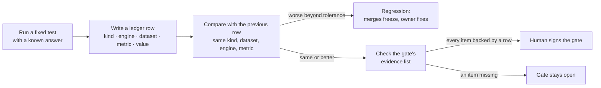

# How Benchmarking Works

*Last updated: 2026-10-16. Kept current by `benchmark` whenever a test, a threshold, a gate or a verdict changes, and checked by the lead at every `plan-sync`.*

The benchmark is the project's referee. It does not build or tune anything. It runs fixed tests with known answers, records every result as a row in the ledger, compares each result with the previous one, and ticks a gate only when the ledger shows the gate's evidence. Today it can tell us that the two engines work and agree with each other. It cannot yet tell us whether a match is good, because the test that answers that (the Helix synthetic set) has not been rendered.

One command runs every test in a fixed order, times each one, and records the run: `python scripts/benchmark_suite.py`. The section below, between the `latest-run` markers, is regenerated from that run and shows the results and run times of the most recent one. `python scripts/benchmark_suite.py --render-doc` refreshes only that section.

<!-- latest-run:start -->
<!-- Generated by scripts/benchmark_suite.py --render-doc from reports/benchmark/latest.json. Do not edit by hand. -->

### Most recent benchmark run

- **Run:** 2026-10-15 21:34 UTC, commit `3829a89-dirty`
- **Machine:** macOS 27.0.1 (arm64, 10 cores, 32 GB); Helix Native 3.82; HX Stomp firmware 3.50
- **Total run time:** 5 min 48 s (348 s), the sum of the test run times below. Skipped and not-available tests count as 0 s.
- **Outcome:** 6 pass, 1 fail, 2 not available.
- **Suite ledger row:** [2026-10-15T21:40:38+00:00](../ledger/runs.csv?plain=1#L214 "benchmark · - · suite · suite_wall_clock_s = 348.25") (`benchmark`, dataset `suite`, metric `suite_wall_clock_s`).

- **Against the previous run:** This is the first recorded run, so there is nothing to compare with yet.

| Test | Status | Key result, and what it means | Pass rule | Run time | Ledger rows |
| --- | --- | --- | --- | --- | --- |
| **Engine smoke, Helix Native** — Native loads a known preset and renders a 2 s clean guitar clip | pass | renders cleanly: peak -13.8 dBFS, 0.17 s per render | length right, no invalid values, peak between -30 and -1 dBFS, at least 20 dB above the noise floor | 7 s | [2026-10-15T21:34:57+00:00](../ledger/runs.csv?plain=1#L185 "smoke · native · smoke · peak_dbfs = -13.82 (first of 2 rows at this time)") (2 rows) |
| **Engine smoke, HX Stomp** — The pedal loads the same preset, renders the clip, and is put back on its own preset | pass | renders cleanly: peak -13.5 dBFS, 2.66 s per render | same checks as Native, health check passes, original preset restored | 13 s | [2026-10-15T21:35:09+00:00](../ledger/runs.csv?plain=1#L187 "smoke · stomp · smoke · peak_dbfs = -13.54 (first of 2 rows at this time)") (2 rows) |
| **Hardware parity (null test)** — Same clean guitar clip and presets K, A, B0, B00 and BT0 through the Stomp and Native, aligned, level-matched and subtracted | pass | null (dB, lower is closer): K -31.0, A -30.9, B0 -37.1, B00 -39.7; delay-tail level, Stomp minus Native +1.3 dB; pedal restored byte for byte | null at or below -30 dB for K, A, B0 and B00; delay tail (BT0) level within 2 dB; 04C restored and byte-diffed | 2 min 22 s | [2026-10-15T21:37:31+00:00](../ledger/runs.csv?plain=1#L194 "parity · both · parity-v0 · null_residual_db = -30.97 (first of 8 rows at this time)") (8 rows), [21:37:32](../ledger/runs.csv?plain=1#L202 "parity · both · parity-v0 · null_residual_db = -16.1 (first of 3 rows at this time)") (3 rows) |
| **Loss trust check (proxy)** — Does each scoring method rank the true setup first among 15 decoys? On stand-in digital effects, not Helix, because the Helix set is not rendered | pass | best held-out rank-1 0.28 (provisional_sum) over 40 items; chance 0.062; combined score 0.28 vs the 0.95 needed on real Helix audio: not trusted yet | no method's held-out rank-1 falls more than 0.05 below the previous run (seeds 9301, 9302); the 0.90 / 0.95 admission rule needs Helix audio | 87 s | [2026-10-15T21:38:58+00:00](../ledger/runs.csv?plain=1#L205 "loss-trust · - · proxy-dsp-v0 · rank1_rate = 0.15 (first of 4 rows at this time)") (4 rows), [21:38:59](../ledger/runs.csv?plain=1#L209 "loss-trust · - · proxy-dsp-v0 · rank1_rate = 0.1 (first of 4 rows at this time)") (4 rows) |
| **Synthetic recovery (CI subset)** — Can the matcher recover known presets from their sound? | not available | Why: not available: the synthetic set has labels only (180 labelled items) and no rendered audio yet | the [Gate 2](../board/GATES.md#gate-2--recovers-known-presets-end-of-week-3 "Gate 2 — recovers known presets (end of week 3)") targets in [docs/BENCHMARKING.md](../docs/BENCHMARKING.md "How Benchmarking Works") | 0 s | none |
| **Separation stress** — How fast does accuracy fall as the mix gets denser? | not available | Why: not available: the synthetic set has labels only (180 labelled items) and no rendered audio yet | recorded as a curve, not gated | 0 s | none |
| **Block-probe validate (synthetic)** — Does the probe analysis measure known synthetic blocks correctly? | pass | 63 of 63 checks within tolerance on 14 known synthetic blocks | every check within its tolerance | 8 s | [2026-10-15T21:39:07+00:00](../ledger/runs.csv?plain=1#L213 "smoke · - · probe-synth-v1 · probe_checks_pass_rate = 1.0") |
| **Offline unit tests (pytest -q)** — The repository's offline tests | **FAIL** | 401 tests passed, 1 failed, 1 skipped Problem: ..."], -- Docs: https://docs.pytest.org/en/stable/how-to/capture-warnings.html =========================== short test summary info ============================ FAILED [tests/test_task_links.py::test_real_docs_are_linked](../tests/test_task_links.py?plain=1#L121 "test_real_docs_are_linked") - AssertionError: ... 1 failed, 401 passed, 1 skipped, 1 warning in 90.33s (0:01:30) | no test fails | 1 min 31 s | none |
| **Lint (ruff)** — Style and simple bug checks on src, tests and scripts | pass | no lint problems in src, tests and scripts | no findings | under 1 s | none |

How to read it: *pass* means the test's rule was met; *fail* means it was not (a fail that was a pass last time is a regression); *skipped* means we chose not to run it or could not, for the reason shown (for example no pedal); *not available* means what the test needs does not exist yet. Neither of the last two is a pass or a failure. A null in dB is how much of the signal is left after subtracting the two outputs; lower is closer. Rank-1 is how often a scoring method put the true setup first; higher is better. Run time is wall-clock seconds on the machine above. The data is in [`reports/benchmark/latest.json`](../reports/benchmark/latest.json "reports/benchmark/latest.json"), and every earlier run in `reports/benchmark/history/`.
<!-- latest-run:end -->

## What it decides, and on what evidence

Three rules govern every conclusion:

1. **A claim without a ledger row did not happen.** Every result is one row in [`ledger/runs.csv`](../ledger/runs.csv): when, which commit, which agent, what kind of test, which engine, which dataset, which metric, the value, and notes. Rows are only ever appended. A wrong row is corrected by a new row, and accidental rows are listed in [`ledger/void.csv`](../ledger/void.csv) and skipped.
2. **Better or worse is always relative to the previous row of the same test.** A comparison only counts when the kind, dataset, engine and metric all match. A drop beyond the tolerance is a regression, and merges freeze until it is fixed.
3. **The ear is the final judge.** The benchmark prepares listening sessions but never scores them. Only the human's ratings decide whether a match is good.

## The tests

| Test | What it answers | How it reaches a result | Pass rule | State today |
| --- | --- | --- | --- | --- |
| **Engine smoke** | Does an engine render at all? | Load a known preset, render a 2-second clean guitar clip, check length, no invalid values, a sensible level, and a clear gap above the noise floor. On the Stomp it also checks the pedal was put back on its original preset. | Every check passes | Passing on both engines; part of the suite |
| **Hardware parity (null test)** | Does the HX Stomp play a preset the same way as Native? | The same clean guitar recording and the same preset go through both. The two outputs are aligned to a fraction of a sample, level-matched with one gain, and subtracted. What is left, relative to the signal, is the "null" in dB; lower means closer. Also reported per octave band and over delay tails. | About -30 dB or lower (the level at which the pedal repeats itself) | Run on several presets; K, A, B0 and the delay-tail pair B00 and BT0 are in the suite; see below |
| **Synthetic recovery** | Can the matcher find a preset when we know the right answer? | 180 test items: known presets rendered through clean guitar clips. The matcher is given only the sound and must recover the blocks, models and settings. Scored on which blocks are on, which models, and how far each setting is off. | The Gate 2 targets below | Designed and labelled, not rendered yet; shown as "not available" in the suite (neither a pass nor a failure) |
| **Separation stress** | How fast does accuracy fall as the mix gets denser? | The same items mixed with other instruments at increasing levels, then separated, then matched. | Recorded as a curve, not gated | Shown as "not available" in the suite until the set has rendered audio |
| **Trust check for a comparison method** | Does a scoring method rank the right preset first? | For each known preset, the true answer and 15 decoys (7 close, 8 random) are scored; the method passes if the true one comes first. Run by `tone-metrics`, with the threshold set by the benchmark. | 0.90 per method, 0.95 for the combined score | Only on stand-in signals so far; best combined about 0.3. The suite runs it in proxy mode on fixed seeds 9301 and 9302 and flags a drop of more than 0.05 against the previous run; the 0.90 / 0.95 rule waits for Helix audio |
| **Block-probe validate** | Does the probe analysis measure blocks whose answer we know? | Known digital blocks (not Helix) are run through the probe and each measured feature is compared with the truth. | Every check within its tolerance | Part of the suite |
| **Unit tests and lint** | Does the code still do what its tests say, and is it tidy? | `pytest -q` and `ruff check`, offline. | No test fails; no lint finding | Part of the suite |
| **Engine comparison** | How much quality does the slower hardware path cost? | The same songs matched on Native and on the Stomp. | Recorded, not gated | Not run |
| **Blind listening (A/B)** | Does a person prefer the match? | Clips are trimmed, level-matched, randomised and given hidden labels; the answer key is kept apart. The human rates them; the benchmark joins ratings and key. | Preferred over the nearest community preset on most songs (Gate 3) | Two informal, non-blind verdicts recorded |

### Hardware parity results so far

| Preset | Null | What it means |
| --- | --- | --- |
| Smoke chain, more-drive variant, Plexi variant (no delay) | -30.4 to -37.5 dB | Same sound on both |
| Song match with the cab's Early Reflections at 0 | -30.5 and -31.4 dB | Same sound on both |
| Song match with Early Reflections at 0.783 | -3.6 dB | Different: this setting behaves differently on firmware 3.50 than in Native 3.82, so it is held at 0 for anything bound for the pedal |
| Delay tails, fixed delay time | +4.3 dB over the tail | Echoes are equally loud but Native's arrive about 0.8% later, so delay tails cannot null across engines; judge delays by level and time, not by null |
| Rendering two chains at once on the Stomp's two paths | -18 to -22 dB against single-path renders (before the layout fix); -72.9 dB after it | The gap was a bug in how two-path presets were written; two-path passes may be used again (lead, 2026-10-16). The spot checks below used single-path renders only |

### Parity spot checks by block type (T060, firmware 3.80, 2026-10-16)

At least five models per block category, each rendered on the Stomp (fw 3.80) and on Native 3.82 from the same `.hlx` and the same clip (4 s of guitar and 2 s of silence), Hum and Ripple at 0, cab Early Reflections at 0. Passing means a null of -30 dB or lower; delays are judged by echo level (within 2 dB) and echo timing. Dataset `parity-spot-fw380`, rows from 2026-10-16T02:31 in the ledger. Two pedal sessions, single-path only.

| Category | Models | Null at -30 dB or lower | Median null | Note |
| --- | --- | --- | --- | --- |
| Distortion | 5 | 2 | -28.6 dB | Scream 808, Kinky Boost pass; Heavy Dist -25.7, Triangle Fuzz -28.6, Bitcrusher -27.4 miss by 1 to 5 dB |
| Delay | 5 | echo level 5 of 5 | -7.0 dB (not a criterion) | Level within 0.5 dB; Native later by ~2.96 ms per echo (+0.79%) on four models, earlier by ~2.1 ms on Adriatic |
| Reverb | 6 | 0 | -15.4 dB | -5.9 (Ganymede) to -22.8 ('63 Spring); the pedal repeats itself at -77.7 dB (Room) |
| Dynamics | 6 | 6 | -36.9 dB | |
| EQ | 5 | 5 | -32.5 dB | |
| Modulation | 6 | 0 | -2.2 dB | The pedal's repeat floor is -1.5 dB (free-running LFO), so a null cannot be used for modulation |
| Amp | 5 | 5 | -41.0 dB | |
| Cab | 5 | 5 | -35.6 dB | |

Cab Early Reflections on 3.80 (K's Blue Bell, ER 0 / 0.25 / 0.5 / 1.0): -28.1 / -12.1 / -6.6 / -1.0 dB. Unchanged from 3.50; the freeze at 0 stays. The first pass refused eight files because the Stomp's block lacks Helix-only parameters (Scale, Spread, Stereo); those files were regenerated without them and passed readback.

### Gate 2 targets (approved as working targets, not frozen)

| Measure | Target | Baseline that must be beaten |
| --- | --- | --- |
| Which blocks are on (block F1, higher is better) | 0.85 or more | 0.64 for "everything on" |
| Right model on the Stomp set (higher is better) | 0.60 or more | about 0.17 by chance |
| Right chain structure on the Native set | 0.80 or more | 0.33 by chance |
| Setting error, 0 to 1 scale (lower is better) | 0.15 or less | 0.19 for "always the middle" |
| Trust check, combined score / per method | 0.95 / 0.90 | 1 in 16 by chance |
| Score on new notes vs the fitted notes | no more than 1.25 times | 1.0 |

They freeze only after two baselines are measured at the same budget: a "middle of every knob" preset, and a random search.

## How a gate is passed

The gates live in [`board/GATES.md`](../board/GATES.md). Each lists evidence items. The benchmark ticks an item only with the timestamp of the ledger row that proves it, and it writes the single `gate` row only after the human has signed. Gate 1 (both engines driven by code) is signed. Gate 2 (recovers known presets) has no evidence yet: it needs the synthetic set rendered, the trust check run on real Helix audio, and the targets frozen. Gate 3 (beats the nearest preset on real songs) needs blind listening on a set of songs.

## Known limits

- **Most "passes" so far are about the plumbing, not about tone.** The engines run and agree; whether the matcher finds the right tone is untested on known answers.
- **The trust check has only seen stand-in signals**, simple digital effects written in code, not Helix models.
- **Listening verdicts are informal:** one song, not blind, by the person who also directed the work.
- **Line-number links into the ledger stay correct only because the ledger is append-only.**

## Sources

- [`scripts/benchmark_suite.py`](../scripts/benchmark_suite.py) and `reports/benchmark/`: the suite runner, `latest.json`, and one file per run in `history/`
- [`.claude/agents/benchmark.md`](../.claude/agents/benchmark.md): the agent's role and rules
- [`.claude/skills/engine-smoke/SKILL.md`](../.claude/skills/engine-smoke/SKILL.md), [`synthetic-benchmark`](../.claude/skills/synthetic-benchmark/SKILL.md), [`parity-null`](../.claude/skills/parity-null/SKILL.md), [`blind-ab-session`](../.claude/skills/blind-ab-session/SKILL.md), [`loss-trust-check`](../.claude/skills/loss-trust-check/SKILL.md): the procedures
- [`docs/notes/synthetic-benchmark-design.md`](notes/synthetic-benchmark-design.md): the synthetic set and the thresholds
- [`contracts/ledger-format.md`](../contracts/ledger-format.md): the ledger format
- [`docs/DECISIONS.md`](DECISIONS.md): the approved targets, the Early Reflections finding, void rows
- [`docs/TONE-COMPARISON.md`](TONE-COMPARISON.md): how a match is scored

## Keeping this document current

`benchmark` updates this file in the same change whenever a test is added or run for the first time, a threshold is set or frozen, a gate changes state, or a parity or listening result changes a conclusion here. The lead checks it at every `plan-sync`. Update the date at the top.
