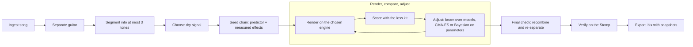

# HX Stomp Tone Matcher — Project Plan

Oct 13, 2026 · Jason

> Repo copy of the living plan. The original, with the two drawn diagrams, is at
> https://claude.ai/code/artifact/47b856f9-f0e4-4523-9a65-0bb9b1efd8b3.
> The companion agent-team plan is [AGENT-TEAM.md](AGENT-TEAM.md).

## Summary

Build a closed-loop "render, compare, adjust" optimizer whose render engine is **chosen by the user**: **Helix Native** for fast offline iteration, or the **HX Stomp itself** for users without Native. Decompiling the firmware is not needed: Native runs the same models as the hardware, and the Stomp's USB control protocol has already been recovered by an open-source project ([fretwire](https://github.com/john-baxter-dev/fretwire)). When both are present, Native searches and the Stomp verifies.

The agent team that builds this, and how it iterates: [AGENT-TEAM.md](AGENT-TEAM.md).

The pipeline: isolate the guitar from the mix, split the song into up to 3 tones (the Stomp's snapshot limit), estimate a starting chain with fast analysis and a learned predictor, then iterate block choices and parameters against a content-robust loss until the rendered tone matches. The output is an `.hlx` preset with snapshots, checked on the real pedal by reamping.

Three risks decide the prototype, and week 1 is spent on them:

1. **Controlling each engine from code.** Native exposes only 16 knob and 16 switch automation slots to a host, and the pedal's control protocol is implemented only on Linux today. Hardware mode is also real time, so it gets a far smaller search budget.
2. **Guitar isolation quality.** The best guitar separators score about 7.5 dB SDR, so the target audio carries artifacts the loss must tolerate.
3. **No dry signal.** Full mixes have no DI, so most comparisons must be insensitive to what notes were played.

## Scope and assumptions

The plan targets an open-source prototype in weeks, built around the gear you already own.

| Topic | Decision | What it implies |
|---|---|---|
| Hardware | HX Stomp **or** Helix Native (at least one required); GPU optional | Either engine can run the search; GPU for separation and model training |
| Device limits | Up to 8 blocks, 3 snapshots per preset, one DSP ([manual 3.80](https://cf3.zzounds.com/media/Line_6_HX_Stomp_Owners_Manual-21bc0c505f3e387877e699d233de93f8.pdf), [specs](https://achamilton.co.uk/Line6/HXSTOMPIIRF.htm)) | One block chain must serve every section of the song |
| Input | Full mixed songs | Guitar isolation is mandatory; no DI available by default |
| Output scope | Full rig or effects-only, selectable | Two export modes: full rig (default) exports amp and cab with the effects; effects-only is an option for playing through your own amp and needs a stand-in for it |
| Tone count | Snapshots per section | Sections are clustered into at most 3 tones |
| Audience | Open source | No Line 6 data or binaries in the repo; Native is optional, and users who choose it bring their own licence |
| OS | Windows, macOS, Linux | Native runs on Windows/macOS, Linux via Wine; pedal control is Linux-only until ported |
| Success | Metrics plus blind listening | A synthetic benchmark with known answers, plus A/B tests on real songs |
| Timeline | Prototype in weeks | Fixed chain template first; learned models later |
| Render engine | User-selectable: Helix Native or the HX Stomp | One engine interface; the search budget adapts to the engine chosen |

Assumed firmware: Helix/HX 3.80, the latest release found ([release notes](https://kb.line6.com/helix-hx-3-80-release-notes)), with Helix Native 3.82.

## Pipeline overview

The system is a linear pipeline around one optimization loop; everything before the loop prepares a target and a starting point, everything after proves and packages the result.

The loop is where the accuracy comes from: each pass renders a candidate through the engine the user chose (Helix Native or the HX Stomp), scores it against the isolated guitar, and adjusts. Steps 1 to 7 below follow the boxes in order.

## Step 1: Ingest and guitar isolation

Start with the open `htdemucs_6s` model and keep the separator pluggable, because guitar separation is the weakest link in the chain.

Decode the file, resample to 48 kHz and loudness-normalize. Then separate the guitar stem and keep the other stems: the comparison trick below needs them.

**User-supplied stems (preferred when available).** The user may hand in a guitar stem they already have, from a multitrack release, their own recording or a stem pack, alongside the original mix. The tool then skips separation entirely and uses the supplied stem, which sidesteps the hardest, lossiest step in the pipeline and needs no GPU. The original mix is always required too, so section detection and the separation-consistent comparison still run against the real song.

**Hosted separation APIs:** a possible future backend (services such as MVSep or LALAL.ai run these same models server-side, removing the local GPU need), but deferred for now because it sends the user's song audio to a third party. CPU separation stays the offline fallback.

| Model | Guitar SDR | Strengths | Weaknesses | Audio samples |
|---|---|---|---|---|
| Ensemble BS + Mel-RoFormer | ~7.5 dB (best measured) | Cleanest guitar; fewest artifacts on dense mixes | Heaviest to run; weights and settings vary by checkpoint, so no universal quality ranking | [MVSep guitar model](https://mvsep.com/algorithms/17) |
| BS-RoFormer (viperx) | ~7.2 dB | SDX23 Sound Demixing Challenge first place; beat the previous best by a large margin | VRAM-hungry; the clearest extra margin is on bass | [lucidrains BS-RoFormer](https://github.com/lucidrains/BS-RoFormer) |
| Mel-RoFormer (2024.06) | ~7.0 dB | mel-scale projection mimics human hearing; strong in the upper mids | Tuned more for vocals than guitar | [MVSep guitar model](https://mvsep.com/algorithms/17) |
| MDX23C | ~6 dB range | Good speed-to-quality balance; part of the MVSep guitar blend | Older architecture than RoFormer | [MVSep guitar model](https://mvsep.com/algorithms/17) |
| Demucs4 HT, 6 stems (`htdemucs_6s`) | ~5.2 dB | Open, easy to install, guitar output built in; hybrid approach suits guitar | Lowest of the five; guitar quality described as so-so | [Demucs demo](https://demucs.danielfrg.com/) |

Source: [MVSep guitar model comparison](https://mvsep.com/algorithms/17) for the SDR figures. Two caveats: going from `htdemucs_6s` to a RoFormer is only about +1.3 dB, so the audible gap can be smaller than the numbers suggest; and most published demos are vocal-focused, so judge guitar by running your own clip through the MVSep guitar model and listening.

**Separation-consistent comparison.** Instead of comparing a clean render against an artifact-laden stem, mix the candidate render back with the song's other stems, separate again with the same model, and compare stem to stem. The artifacts then appear on both sides. It costs one separation per evaluation, so use it only in the final refinement stage.

**Comparison methods, layered.** Recombine-and-re-separate is not the only way to compare a candidate against the stem, and it is not free, so the tool offers a ladder of benchmarks and picks the cheapest one that is trustworthy at each stage:

- **Artifact-robust embeddings (cheap, bulk of the search).** Compare learned tone fingerprints trained to ignore separation noise, rather than raw audio. No re-separation, so this carries most of the optimization.
- **Confidence-masked comparison.** Score only the time-frequency regions the separator is confident about, ignoring the smeared ones.
- **Exposed-guitar sections.** Prefer intros, breaks and other spots where the guitar is nearly solo, so separation barely matters.
- **Separation-consistent comparison (expensive, final candidates).** The recombine-and-re-separate method above, reserved for the last few candidates where the fairest possible judgment is worth one extra separation each.
- **Pure listening (final gate).** A blind A/B listen by a human on the top candidates. Numbers can agree while the tone is wrong, so no match is called done until it passes the ear. This feeds the same blind-listening evaluation used in the Evaluation plan.

The tool runs several of these in parallel and can weight them, rather than relying on any single score.

**Several guitars in one stem.** Separators return all guitars together. First-pass heuristics: split hard-panned doubles by left/right and mid/side, and split rhythm from lead by register and density. A longer-term option is [Fx-Encoder++](https://arxiv.org/html/2507.02273v1), which extracts per-instrument effect embeddings directly from the mixture and could reduce dependence on separation.

## Step 2: Section segmentation for snapshots

Cluster the song's guitar tone into at most 3 groups, one per snapshot, and solve all of them with a single shared block chain.

1. Detect beats and section boundaries (verse, chorus, solo) on the full mix.
2. Compute a tone embedding for each guitar window of about 2 s, skipping silence and near-silent windows.
3. Cluster the windows; merge clusters until there are 3 or fewer, and show the user which bars map to which snapshot so they can override it.

**Why one chain matters.** Snapshots recall block bypass states and parameter values, but every snapshot shares the same models in the same slots. The optimizer therefore searches for one chain of up to 8 blocks that covers all clusters, with per-snapshot bypass and parameter values. A song needing more than 3 distinct tones becomes several presets.

## Step 3: The missing dry signal

Ship two zero-effort options first (a reference DI library plus a blind predictor), offer recording your own DI as an "accuracy mode", and treat blind DI recovery as a research track.

To render a candidate tone you need dry guitar to feed it. Full mixes contain only the processed result, so each option below trades effort against fidelity.

Ranked best to worst for fidelity, with what we build now called out. "Build now" is the v0 cut; the rest are later or research.

| Rank | Option | How it works | Fidelity | Build now? |
|---|---|---|---|---|
| 1 | A. User records own DI | User plays the part into the Stomp; USB 5/6 carries the dry input, USB 1/2 the processed tone | Highest: real guitar and pickups, most accurate EQ and gain | Later (v1 accuracy mode) — opt-in, needs user effort |
| 2 | A+B hybrid | Rough DI recovered from the stem, then matched against reference DIs to fill gaps and sanity-check | High when recovery is decent; degrades gracefully to B | Research — fold in once C is viable |
| 3 | C. Blind DI recovery | An effect-removal model estimates the DI from the separated stem | Good when it works: time-aligned, allows sample-level losses | Research — weak on heavy distortion, needs training data |
| 4 | B. Reference DI library | Pick clean DI clips matched to register and style (e.g. EGDB) | Moderate: pickup and guitar mismatch biases EQ and gain | **Build now (v0 default)** — zero effort, deterministic |
| 5 | E. Blind estimation | A network predicts blocks and settings from the wet audio alone, no DI | Approximate: only knows what it was trained on | **Build now (v0 starting point)** — instant, seeds the search |
| 6 | D. Transcribe and resynthesize | Transcribe notes, render a synthetic DI | Lowest: synthetic DI timbre is unrealistic | No — low priority |

Note on the ranking: A and E sit at opposite ends. A is the most *faithful* when the user does the work, while E is the least faithful but the most *useful as a starting guess* because it needs nothing from the user. That is why both B and E are the v0 build: B gives the search real dry audio to render, E gives it a smart first guess, and neither asks anything of the user.

Two published results set expectations for option E: a CNN classified 13 drive and fuzz effects with over 80% accuracy and mostly under 0.05 mean absolute parameter error, and a second study kept errors under 0.05 for chorus, phaser, reverb and overdrive even inside full mixes.

**Data advantage.** Options C and E need paired dry/wet training data. Native can render that in bulk on CPU, with the GPU used for training (hardware-only users get the trained model from the project; see Step 4): EGDB DI clips through thousands of random but plausible Helix chains. This is the same synthetic-data approach as [Open-Amp](https://arxiv.org/html/2411.14972v1), applied to the exact models we export.

## Step 4: Render engine, chosen by the user

Users pick the engine per run: **Helix Native** (fast, offline, needs a licence) or the **HX Stomp itself** (real time, no extra purchase). Both sit behind one interface, and the optimizer adapts its search to the engine's speed.

**One interface, two engines.** Every engine implements the same small contract, so Steps 1 to 3 and 5 to 7 never know which one is running:

- `load(preset)` and `set_params(changes)` put a candidate on the engine.
- `render(dry_clip)` returns the processed audio, level-matched and latency-trimmed.
- `cost()` reports seconds per render and how many renders can run at once; the optimizer uses it to pick its strategy and budget.
- `capabilities()` reports firmware version and available models.

At startup the tool detects what is present. With both available, the default is Native for the search and the Stomp for verification; the user can force either engine for everything.

|  | Helix Native mode | HX Stomp mode |
|---|---|---|
| Suits | Users with a Native licence | Any HX Stomp owner |
| Extra cost | Native licence; about $100 for registered hardware owners ([forum, 2022](https://line6.com/support/topic/63073-helix-vs-hx-stomp/)) | None |
| Render speed | Faster than real time, several processes in parallel (to be measured) | Real time: a 4 s clip takes 4 s plus settling |
| Renders per tone (planning estimate) | Hundreds to a few thousand | About 100 to 300, roughly 10 to 25 minutes |
| Control from code | Plugin state or 16 knob + 16 switch automation slots ([forum](https://line6.com/support/topic/47525-helix-native-midi-operations-in-logic-pro-x/)); spike in week 1 | [fretwire](https://github.com/john-baxter-dev/fretwire) USB protocol: blocks, models, parameters; MIDI CC as fallback |
| Operating systems today | Windows, macOS; Linux via Wine | Linux with fretwire; Windows and macOS need a port or the MIDI fallback |
| Fidelity to the pedal | Same models; confirmed by a parity test when a Stomp is present | Exact: it is the target device |

### Helix Native mode

Spotify's [pedalboard](https://github.com/spotify/pedalboard) loads VST3 plugins on macOS, Windows and Linux and renders offline from Python; DawDreamer is the fallback host. The open question is how to push a whole preset into the plugin:

- Write the plugin's saved state blob directly. pedalboard exposes raw state, and some plugins store XML or JSON inside it ([example](https://www.github.com/spotify/pedalboard/issues/277)); if Native embeds preset JSON there, we can generate it.
- Assign up to 16 knobs and 16 switches to the parameters being tuned, once per chain structure, and drive those from the host.
- Map parameters to MIDI CC, which Native has supported since 1.60 ([KB](https://kb.line6.com/helix-native-midi-operations-in-a-daw)).
- Last resort: script Native's preset import through its GUI.

Users report Native working on Linux in Reaper via Wine and yabridge ([forum](https://line6.com/support/topic/69393-helix-edit-under-linux-arch/), [setup notes](https://gist.github.com/torgeir/e03a0759268ac07ec1295c5c175d5522)); treat that as best-effort. Pin the original Helix Native 3.8x: presets saved by Helix Stadium Native cannot be loaded back into first-generation devices ([Line 6 manual](https://manuals.line6.com/helix-stadium-native/live/preset-compatibility)).

### HX Stomp mode

**Audio path.** The Stomp is an 8-in, 6-out USB interface with reamping. Send the dry clip to USB 5/6 with the preset's Input block set to USB 5/6, and record USB 1/2 ([reamp thread](https://line6.com/support/topic/61328-reamping-reamp-with-garageband-gb-and-hx-stomp/)). Measure round-trip latency once with an impulse and trim every render by it.

**Control path.** fretwire sends block, model and parameter edits over the pedal's USB control interface without HX Edit. It is Linux-only today and, per a user report, Helix hardware does not report its sample rates in a class-compliant way on Linux ([forum](https://line6.com/support/profile/455629-digitalscream/content/)). Two routes to Windows and macOS:

1. Port fretwire's protocol crates; the week-1 spike checks whether the Line 6 driver and HX Edit can coexist with a second controller.
2. MIDI CC fallback: build a template preset per candidate chain with its tuned parameters assigned to MIDI CCs, load it once, then sweep values over USB MIDI. Models cannot change without loading another template, and values have 128 steps.

**Making a small budget count.** Hardware renders one candidate at a time, so this mode leans harder on everything that avoids renders:

- Short excerpts of 2 to 4 s chosen to expose the tone: a sustained chord, a muted riff, a note tail for delay and reverb.
- Successive halving: score many candidates on 1 s of audio, then only the best on the full excerpt.
- Sample-efficient Bayesian optimization instead of large CMA-ES populations.
- Measured delay, reverb and modulation settings, and the pre-trained predictor, as starting values.
- Group trials by chain so model changes, which need more settling than parameter tweaks, happen rarely.
- Worth testing: the Stomp outputs Path A and Path B on separate USB pairs, which might render two small candidate chains at once.

**The predictor without Native.** Training the blind predictor needs thousands of renders. Either maintainers render them with Native and publish the trained model, or a user renders them overnight on the pedal (about 12 hours for 10,000 clips of 4 s, as an estimate).

### Options rejected or deferred

- **Decompile or emulate the firmware: rejected.** Months of work and legal risk, for no gain over Native or the pedal itself.
- **Neural proxies of each block: later.** Trained once on Native renders, they would give hardware-only users a fast, GPU-batched inner loop, with the Stomp confirming the final candidates ([DeepAFx-ST](https://arxiv.org/pdf/2207.08759) uses this idea).

## Step 5: Search space and preset representation

Search in three layers (chain structure, model per slot, then parameter values), starting from a fixed 8-slot template so the prototype never searches structure blindly.

**The file format.** An `.hlx` preset is plain JSON ([examples](https://huggingface.co/datasets/RustyBytes/helix/blob/main/AndTClean.hlx)):

- `data.device` identifies the target; HX Stomp presets carry `2162694`, alongside `device_version` and `meta`.
- `tone.dsp0.block0…blockN` hold each block's `@model` (e.g. `HD2_AmpUSDoubleVib`), `@enabled`, `@position`, `@path`, `@stereo` and its parameter values.
- `tone.controller` holds snapshot and controller assignments; snapshots and footswitches sit alongside.

**The model catalog.** Parameter names, ranges and model IDs ship inside HX Edit's resource folder as JSON. fretwire imports them at runtime from the user's own install and redistributes nothing; this project should copy that pattern. [HelixHelp](https://helixhelp.netlify.com/models/) lists every model and what it is based on, which helps build priors and readable output.

**Constraints the search must respect.**

- At most 8 blocks on one DSP, and a DSP budget: heavy combinations are refused, and some community-generated presets fail to load for that reason ([forum](https://line6.com/support/profile/3235787-rjkole/content/)). Build a per-model DSP cost table during the spikes.
- Models are shared by all 3 snapshots; snapshots change only bypass and values.
- Amp and cab pairing: search amp+cab blocks, or amp plus a separate cab, not free combinations.

**Layered search.**

1. Structure: which categories are present (compressor, drive, amp, cab, EQ, modulation, delay, reverb). v0 uses a fixed template of exactly these 8 slots, with unused slots bypassed.
2. Model per slot: a short list from the blind predictor, scored by quick trials.
3. Parameters: continuous refinement of the chosen models, roughly 40 to 80 dimensions in total, tuned in stages (gain and EQ first, then time-based effects).

**Two export modes, chosen by the user.** A recording's tone is effects, amp, cab and mic together, and the tool always optimizes that whole chain in simulation. The mode only decides what goes into the exported preset.

- **Full-rig mode (default).** Everything is searched and everything is exported: drive, compressor, **amp, cab**, EQ, modulation, delay and reverb. The preset is a complete tone you plug straight into a PA, FRFR speaker or headphones.
- **Effects-only mode (optional).** For players who run the Stomp in front of their own amp. The amp and cab stand in for the user's real amp and are held fixed rather than searched, and only the effect blocks are exported. Drives and compressors go before the amp; modulation, delay and reverb can sit in the amp's loop using the Stomp's 4-cable method.

Switching modes doesn't require a re-run: a full-rig result can be exported effects-only by dropping the amp and cab blocks, though accuracy is best when effects-only is searched against the user's own stand-in from the start.

## Step 6: Matching and iteration loop

Measure each effect with the cue that reveals it, combine those into one loss, and search with gradient-free optimizers seeded by a predictor and constrained by a prior over realistic presets.

**Losses.** Because the dry signal usually differs from the song's performance, most terms compare statistics or embeddings rather than waveforms.

| Term | Captures | Needs aligned DI? |
|---|---|---|
| Long-term average spectrum, spectral tilt | Cab, EQ, overall voicing | No |
| Crest factor, spectral flatness, harmonic-to-noise ratio | Gain and distortion amount | No |
| Envelope and attack statistics | Compression, gating | No |
| Learned effect embeddings: AFx-Rep ([ST-ITO](https://arxiv.org/html/2410.21233v1)), [Fx-Encoder++](https://arxiv.org/html/2507.02273v1), an [Open-Amp](https://arxiv.org/html/2411.14972v1)-style guitar encoder | Overall effect character, robust to notes played | No |
| Delay: echo peaks in onset-envelope autocorrelation, snapped to note values at the song's tempo | Delay time, feedback, mix | No |
| Reverb: decay of note tails | Reverb time and mix | No |
| Modulation: periodicity of centroid and pitch wobble | Chorus, phaser, tremolo rate and depth | No |
| Multi-resolution STFT / log-mel distance | Fine detail | Yes (options A with alignment, C) |

Delay, reverb and modulation settings can often be **measured** directly rather than searched; those measurements become starting values.

**Search, in four stages.**

1. **Seed.** The blind predictor (trained on Native renders) proposes the top few models per slot; nearest-neighbour retrieval over a preset library adds whole-chain candidates.
2. **Model selection.** Beam search over candidate models, each scored after a short tuning run of its key parameters.
3. **Parameter refinement.** CMA-ES (pycma or Nevergrad) or Bayesian optimization (Optuna, BoTorch), stage by stage. [ST-ITO](https://arxiv.org/html/2410.21233v1) shows this pairing of gradient-free search and a learned style metric works on non-differentiable effects.
4. **Final check.** Separation-consistent comparison (Step 1) on the best few candidates, then the hardware check (Step 7).

**Prior over presets.** Pure loss minimization can land on odd settings. Adding a Gaussian prior over parameters turns the search into maximum-a-posteriori estimation; on vocal effects this reduced parameter error by up to 33% ([Yu et al. 2025](https://arxiv.org/abs/2505.11315)). Fit the prior on community and factory presets, such as the [RustyBytes/helix](https://huggingface.co/datasets/RustyBytes/helix/blob/main/AndTClean.hlx) dataset.

**Budget per engine.** Budget in renders per tone, using the engine's measured `cost()`. As planning estimates: Native mode allows hundreds to a few thousand renders and suits CMA-ES with large populations; HX Stomp mode allows about 100 to 300 and suits Bayesian optimization with successive halving, starting from the predictor and measured settings. The report tells the user which engine and budget produced each preset.

## How it learns

The system never searches at random. It improves in two ways: a guided search that converges within one song, and learned models that make every future song start closer to the answer.

**Within a song: measure, then climb.** Each effect leaves a measurable fingerprint, so the loop reads cues rather than guessing blindly:

- Spectral tilt and the long-term average spectrum point at the amp, cab and EQ.
- Crest factor and harmonic content point at how much gain and distortion is present.
- Echo peaks in the onset envelope give delay time and feedback; note-tail decay gives reverb; periodic wobble gives modulation rate and depth.

Delay, reverb and modulation can often be **measured directly** and set, not searched. For the rest, an optimizer (CMA-ES or Bayesian optimization) moves toward a lower loss each pass, so the match improves monotonically instead of flailing. This is deterministic improvement inside a run, not learning that carries over.

**Across songs: three learned components that compound.**

1. **The blind predictor (the main self-improvement loop).** Render thousands of dry clips through known Helix chains, so every example has a correct answer, then train a network to predict the chain and settings from a tone. It becomes the search's starting guess. More training data, or data closer to real songs, means a better guess, which means fewer renders and closer matches over time. This is the piece that "gets better" as the project matures.
2. **A learned tone-similarity metric.** The loss itself can be a trained embedding (AFx-Rep, Fx-Encoder++, an Open-Amp-style guitar encoder) that judges how alike two tones sound, robust to which notes were played. A better metric means the search climbs toward matches that actually sound right, not just ones with similar numbers.
3. **Neural proxies of each block (true gradient learning).** Train a differentiable network to imitate each Helix block from Native renders. Because it is differentiable, settings can be refined by gradient descent rather than search, and it gives hardware-only users a fast inner loop. This is genuine learning of the models' behaviour, and it is the longer-term track.

**A flywheel.** Every matched preset the project verifies is a new paired example. Fed back into the predictor and the metric, successful matches become training data for the next version, so the tool's starting accuracy rises with use. The evaluation set with known answers keeps each retrain honest.

**What it does not do.** It does not invent new amp or effect models; it works entirely within the Helix models the HX Stomp can run. "Modeling the sound" here means learning to choose and set those existing blocks, not synthesizing a tone from scratch.

## Step 7: Output generation and hardware verification

Write the `.hlx` from a template exported by Native in HX Stomp mode, then prove it on the pedal before calling a match done.

1. **Template.** Export one preset from Native in HX Stomp compatibility mode and one from HX Edit with the Stomp connected. Keep both as golden templates and diff generated files against them.
2. **Generate.** Fill blocks, snapshot values, bypass states, snapshot names (Verse, Chorus, Solo) and footswitch assignments. Match `device_version` to the user's firmware.
3. **Validate.** Load the file in Native (HX Stomp mode) if installed, import it in HX Edit, and load it onto the pedal. HX Edit rejects files built for other devices with error -8309 ([forum](https://line6.com/support/topic/71517-converting-helix-floor-preset-to-hx-stomp-preset/)), which makes it a useful validator.
4. **Parity test.** When both engines are present, reamp the same DI through the Stomp and through Native with the same preset; level-match and null the two. Any residual is a Native-versus-hardware gap to measure once and track per firmware.
5. **Hand-off.** Give the user the preset, a short report per snapshot (chain, key settings, match scores), and the A/B audio.

## Evaluation plan

Judge progress on a synthetic benchmark with known answers every week, and on real songs with blind listening at each milestone.

| Test | Built from | Measures | When |
|---|---|---|---|
| Synthetic recovery | DI clips rendered through random but plausible Native presets, then mixed with stems from multitrack songs | Block-type F1, model accuracy, parameter error, loss on held-out notes | Every change (CI) |
| Separation stress | Same, at increasing mix density | How fast accuracy falls as separation worsens | Weekly |
| Real songs | 20 songs you choose, spanning clean to high gain | Blind A/B and MUSHRA-style ratings against two baselines: nearest community preset, and a text-only AI preset | Milestones |
| Hardware parity | Same DI through Stomp and Native | Null residual after level match | Once per firmware |
| Engine comparison | The same songs matched in Native mode and in HX Stomp mode | How much match quality the smaller hardware budget costs, and wall-clock time per tone | Milestones |

A useful sanity rule: a loss is only trusted once it ranks the true preset first on the synthetic set.

## Prototype roadmap

A working end-to-end prototype on real songs is realistic by week 4, provided gate 1 passes in week 1.

```mermaid
flowchart LR
  P1["Week 1: Spikes<br/>Native state via Python · .hlx round-trip<br/>Stomp control on 3 OSes · engine interface"]
  G1{{"Gate 1<br/>both engines driven by code"}}
  P2["Weeks 2–3: Loop v0<br/>separation + sections · DI library, loss kit<br/>CMA-ES on the fixed template · synthetic benchmark"]
  G2{{"Gate 2<br/>recovers known presets"}}
  P3["Week 4: Real songs<br/>snapshots + .hlx export · Stomp parity null test<br/>blind A/B"]
  PB["No-DI research + blind single-block set"]
  G3{{"Gate 3<br/>blind single-block prediction"}}
  PR["Real pedals: dry take held out"]
  G4{{"Gate 4<br/>matches real pedals"}}
  G5{{"Gate 5<br/>beats the nearest preset"}}
  P4["Weeks 5–6: Learned seeding"]
  P1 --> G1 --> P2 --> G2 --> PB --> G3 --> PR --> G4 --> P3 --> G5 --> P4
```

Gate 1 now covers both engines. If Native cannot take whole presets from code, Native mode falls back to 16 automation knobs per fixed chain; if the pedal protocol cannot be ported, hardware mode on Windows and macOS falls back to MIDI CC on template presets. After week 6: neural proxies (which also speed up hardware-only users), blind DI recovery and per-instrument embeddings.

## Risks, unknowns and spikes

The first risk below decides the architecture, so its spike runs first; the rest have workable fallbacks.

| Risk | Impact | Spike or mitigation | Fallback |
|---|---|---|---|
| Native cannot be loaded with arbitrary presets from code | High: blocks the fast loop | Inspect Native's saved state from pedalboard; check whether preset JSON sits inside it | 16+16 automation slots per fixed chain; MIDI CC; hardware loop | Resolved at Gate 1: whole-preset write rejected (opaque state); chain-template replay + 16+16 automation works (replay null -72.9 dB); one GUI capture per chain structure remains the limit; next spike T018.
| Separation artifacts mislead the loss | High | Separation-consistent comparison; artifact-robust embeddings | Ask the user for a cleaner source or a section with exposed guitar |
| DI mismatch biases EQ and gain | Medium | Content-invariant losses; several reference DIs per tone | Accuracy mode with the user's own DI |
| Search space too large for the budget | Medium | Fixed template, measured starting values, predictor seeding | Fewer tuned parameters; user picks the amp family |
| Native and Stomp differ | Low to medium | Parity null test | Final refinement on hardware via fretwire |
| Native and HX Edit versions out of step with firmware (HX Edit 3.51 here vs firmware 3.80) | Medium: stale catalog | Upgrade to HX Edit 3.82, re-run catalog-import | Pin versions in DEV-ENV |
| Native EULA silent on ML training from Native renders | Medium: limits published weights | Read installer EULAs; prefer hardware renders for published models | Ask Line 6 | Retired 2026-10-15: the human reviewed the installer EULAs and found no problem.
| Native on Linux | Low | Wine + yabridge test | Develop on Windows or macOS |
| Studio processing on the record (doubling, mix-bus compression, room mics) | Medium: limits how close any preset can get | Add an optional output EQ block; report the residual honestly | Document as a known limit |
| Several guitars in one stem | Medium | Pan and register heuristics; user picks the part | Instrument-wise embeddings later |
| Pedal control unavailable on Windows and macOS | High for hardware-only users on those systems | Week-1 spike: build fretwire's protocol crates there; check coexistence with the Line 6 driver. Cycle 1: crates build on macOS and tests pass; macOS control plausible, Windows likely MIDI CC; macOS USB control confirmed on hardware, firmware 3.50 (2026-10-14); Linux and Windows unverified | MIDI CC sweeps on template presets |
| Hardware budget too small for a close match | Medium | Short excerpts, successive halving, Bayesian optimization, strong predictor seeding | Neural proxies for a fast inner loop; longer unattended runs |
| Predictor training depends on Native renders | Medium | Maintainers train it and publish the model, if the Native licence allows | Train from overnight hardware renders |

## Legal and licensing for open source

Keep every Line 6 asset on the user's machine, avoid decompiling, and pick a GPL-compatible licence. This is a practical summary, not legal advice.

- **No Line 6 files in the repo.** Import the model catalog from the user's own HX Edit install at runtime, as fretwire does. Native is optional; users who choose it bring their own licence.
- **Avoid firmware decompilation.** Software licences often forbid reverse engineering, and a US appeals court held such clauses enforceable in Davidson v. Internet Gateway ([summary](https://www.patentarcade.com/?p=1129)). The DMCA's interoperability exemption, section 1201(f), is narrow.
- **Protocol interop.** fretwire recovered the USB protocol by observing traffic and ships under MIT/Apache; depending on it is lower risk, but read Line 6's EULA before extending it.
- **pedalboard is GPLv3** (it bundles JUCE and the VST3 SDK under their GPL options, per a [downstream package's note](https://pypi.org/project/hyperframes-vst-host/)). Either license the project GPLv3 or isolate the host in a separate process.
- **Songs and datasets.** Users process their own files locally; the project never hosts song audio. Check each dataset's licence (EGDB, separation checkpoints) before bundling or training on it.
- **Song metadata.** Only artist and title strings may leave the machine, opt-in, never audio. MusicBrainz core data is CC0 but its tags and genres are CC BY-NC-SA 3.0: use and cache locally, never commit or embed in shared models ([licence](https://musicbrainz.org/doc/About/Data_License)). Spotify's terms forbid ML use of its content. Artist-gear sites: manual lookup only unless their terms say otherwise. See `docs/notes/song-context.md`.
- **Trademarks.** Name Line 6 products only to say what the tool works with.
- **Trained models.** A predictor or neural proxy trained on Native renders and shared with hardware-only users is derived from Native's output. **Ruled 2026-10-18 by the human: such weights may be published** (docs/DECISIONS.md), with a model card, no Line 6 assets, and third-party base-weight licences respected. Training from hardware renders remains the fallback if that ever changes.

## Documentation and resource index

These are the documents gathered so far, grouped by what each one is for. Line 6 publishes no in-depth per-parameter reference for Helix models, so parameter meaning comes from the manuals, HelixHelp and the real devices the models are based on.

**Line 6 hardware and software**

| Document | Use it for |
|---|---|
| [HX Stomp Owner's Manual 3.80](https://cf3.zzounds.com/media/Line_6_HX_Stomp_Owners_Manual-21bc0c505f3e387877e699d233de93f8.pdf) | Blocks, snapshots, USB audio, MIDI, global settings |
| [HX Stomp Owner's Manual 3.0 Rev D](https://line6.com/data/6/0a020a418962611d636e7c51b/application/pdf/HX%20Stomp%203.0%20Owner's%20Manual%20-%20Rev%20D%20-%20English%20.pdf) | DI recording and reamping walkthrough |
| [Helix/HX 3.80 release notes](https://kb.line6.com/helix-hx-3-80-release-notes) | Latest models and fixes |
| [Helix Native download and notes](https://line6.com/download-helix-native) | Native 3.82 install |
| [Helix Native Pilot's Guide 3.80](https://line6.com/data/6/0a00051afef2673cd2e8a197b/application/pdf/Helix%20Native%20Pilot's%20Guide%203.80%20-%20English%20.pdf) | Automation slots, compatibility modes, preset import |
| [Helix Native MIDI operations](https://kb.line6.com/helix-native-midi-operations-in-a-daw) | MIDI CC control of parameters |
| [Helix Stadium Native preset compatibility](https://manuals.line6.com/helix-stadium-native/live/preset-compatibility) | Why to avoid Stadium Native |
| [HelixHelp model list](https://helixhelp.netlify.com/models/) | Every model and what it is based on |

**Code and data**

| Resource | Use it for |
|---|---|
| [fretwire](https://github.com/john-baxter-dev/fretwire) | HX Stomp USB control protocol, `.hlx` parsing, catalog import |
| [TonePush](https://github.com/crmne/tonepush) | Second open HX USB client, PROTOCOL.md and opcode dictionary; cross-check for fretwire; summary in `docs/notes/fretwire-protocol.md` |
| [Line 6 standard EULA](https://line6.com/software/eulas/standard.html) | Reverse-engineering, hosting and licence limits; summary in `docs/notes/line6-eula-flags.md` |
| [helixgen](https://pypi.org/project/helixgen/) | Python `.hlx` generation from JSON recipes (Stadium-focused) |
| [RustyBytes/helix](https://huggingface.co/datasets/RustyBytes/helix/blob/main/AndTClean.hlx) | Real `.hlx` presets for format reference and priors |
| [pedalboard](https://github.com/spotify/pedalboard) | Hosting Native from Python |
| [Native under Wine notes](https://gist.github.com/torgeir/e03a0759268ac07ec1295c5c175d5522) | Linux setup |
| [EGDB](https://astro.paperswithcode.com/dataset/egdb), [EGDB-PG](https://arxiv.org/html/2504.07406v1) | DI guitar clips and amp-rendered versions |
| [MVSep guitar benchmark](https://www.mvsep.com/algorithms/17) | Choosing a separator |
| [MusicBrainz API](https://musicbrainz.org/doc/MusicBrainz_API), [rate limits](https://musicbrainz.org/doc/MusicBrainz_API/Rate_Limiting), [data licence](https://musicbrainz.org/doc/About/Data_License) | Song metadata (year, tags) from artist + title; primary source in `docs/notes/song-context.md` |
| [Wikidata licensing](https://www.wikidata.org/wiki/Wikidata:Licensing), [Wikimedia User-Agent policy](https://foundation.wikimedia.org/wiki/Policy:Wikimedia_Foundation_User-Agent_Policy) | CC0 fallback for artist genre and era |
| [Last.fm API terms](https://www.last.fm/api/tos), [Spotify developer terms](https://developer.spotify.com/terms), [Discogs API terms](https://support.discogs.com/hc/en-us/articles/360009334593) | Song-metadata terms reviewed (Last.fm optional with the user's key; Spotify rejected for its ML clause; Discogs terms unread) |
| [Equipboard robots.txt](https://equipboard.com/robots.txt) | Evidence that artist gear lists are manual-lookup only |

**Research**

| Paper | Relevance |
|---|---|
| [ST-ITO (Steinmetz et al., ISMIR 2024)](https://arxiv.org/html/2410.21233v1) | Gradient-free search with a learned effects metric; code released |
| [Gaussian prior for ITO (Yu et al., 2025)](https://arxiv.org/abs/2505.11315) | Preset prior as MAP estimation |
| [Fx-Encoder++ (ISMIR 2025)](https://arxiv.org/html/2507.02273v1) | Per-instrument effect embeddings from mixtures |
| [Open-Amp](https://arxiv.org/html/2411.14972v1) | Synthetic data for guitar-effect encoders |
| [AFx-Rep licence and alternatives (T190)](notes/afxrep-licence.md) | Licence trail of the AFx-Rep weights and training data; permissive and NC alternatives |
| [RelFx (ISMIR 2026)](https://arxiv.org/abs/2608.10573) | Relative effect-distance encoder; code MIT, checkpoint CC BY-NC-SA 4.0 ([repo](https://github.com/TMEGalaxyAudioEffect/relfx)) |
| [DeepAFx-ST](https://arxiv.org/pdf/2207.08759) | Neural proxies for non-differentiable effects |
| [Comunità et al., guitar effect recognition](https://arxiv.org/abs/2012.03216v1) | Effect classification and parameter regression |
| [Hinrichs et al., effects from mixes](https://doaj.org/article/aa41cd04717743b5b0c1fc3b97a16ad9) | Parameter extraction inside full mixes |
| [Guitar effect chain classification (DAFx 2025)](https://dafx25.dii.univpm.it/wp-content/uploads/2025/09/DAFx25_paper_16.pdf) | Multi-effect chains |
| [Blind estimation with an auto-encoder](https://arxiv.org/html/2310.11781v1) | Why parameter distance misleads; audio-domain loss |
| [Unsupervised nonlinear effect estimation (DAFx 2025)](https://arxiv.org/pdf/2504.04751v2) | Blind identification of distortion |
| [Imort et al., distortion removal](https://arxiv.org/pdf/2202.01664) and [two-stage recovery](https://arxiv.org/pdf/2407.16639) | DI recovery |
| [Okita and Katayose, predict then search (2026)](https://arxiv.org/html/2604.22276) | Closest published hybrid: DNN seed plus CMA-ES; survey in `docs/notes/no-di-survey-estimation.md` |
| [StemFX (2026)](https://arxiv.org/abs/2607.15634) | Autoregressive FX-chain prediction trained on separated stems |
| [EG-VAE (2026)](https://arxiv.org/html/2608.05513v1), [LOUDAR (2026)](https://arxiv.org/html/2608.01972v1) | Newer dry-guitar recovery: supervised VAE, unsupervised diffusion prior |
| [Posterior-sampling distortion restoration (2025)](https://arxiv.org/html/2501.05959) | Blind, unpaired restoration of memoryless distortion |
| [Hayes et al., flow-matching synth inversion (ISMIR 2025)](https://arxiv.org/html/2506.07199), [MNPE (2026)](https://arxiv.org/html/2605.13551v1) | Posterior heads for mixed discrete and continuous parameters |
| [Zero-shot amp modelling with tone embedding (2024)](https://arxiv.org/html/2407.10646) | Reference-tone embedding that tolerates different content |
| [GOAT dataset (2025)](https://arxiv.org/html/2509.22655) | Paired DI and NAM-amp guitar, by request, research only |
| [Fx-Encoder (Koo et al., ICASSP 2023)](https://arxiv.org/pdf/2211.02247), [code, MIT](https://github.com/jhtonykoo/music_mixing_style_transfer) | Contrastive effect encoder; checkpoints trained on MUSDB18; `embed_fxenc` |
| [Tone embedding for one-to-many amp modelling (Chen et al., ISMIR 2024)](https://arxiv.org/html/2407.10646v1) | Contrastive "same tone, different content" guitar encoder; no checkpoints found |
| [EG-VAE (Yeh et al., Aug 2026)](https://arxiv.org/abs/2608.05513) | Guitar tone/content disentangling, tone transfer and DI recovery; checkpoint status unknown; see `docs/notes/no-di-survey-metrics.md` |
| [TimberAgent / TRR](https://arxiv.org/html/2603.09332) | Gram-matrix texture descriptor for guitar-effect retrieval |
| [KAD (kernel audio distance)](https://arxiv.org/html/2502.15602v1) | MMD-based distribution distance, candidate for the different-DI trust check |
| [McDermott and Simoncelli, sound textures](https://mcdermottlab.mit.edu/papers/McDermott_Simoncelli_2011_sound_texture_synthesis.pdf) | Time-averaged texture statistics |
| [Gradient-based optimisation of modulation effects](https://arxiv.org/pdf/2601.04867) | Handling unknown LFO phase in a loss |
| [LLM2Fx-Tools](https://arxiv.org/html/2512.01559v2) | Fx-chain estimation with and without dry audio; MUSHRA design |
| [Take et al., chain estimation and dry recovery (DAFx 2024)](https://dafx.de/paper-archive/details/ndvW6hLizkhxZP2em_SaEA) | Iterative effect removal on guitar |
| [Guitar-TECHS](https://arxiv.org/pdf/2501.03720) | Three players, different guitars and hardware; source of the T041 DIs |
| [ElectroSmash archive mirror](https://electrosmash.mas-effects.com/) (canonical [electrosmash.com](https://www.electrosmash.com/), not reachable from the workspace) | Circuit analyses with gains, corners, diodes and input impedances for TS, RAT, DS-1, Distortion+, Big Muff, Fuzz Face, Klon, Guvnor, Rangemaster; main source of `docs/notes/distortion-fundamentals.md` |
| [Yeh, Abel, Smith, DAFx-07](https://dafx.de/paper-archive/details/mIq7vlQKu6pUlF467vvhgw), [Yeh publications](https://ccrma.stanford.edu/~dtyeh/papers/pubs.html) | Distortion/TS as conditioning filter, memoryless nonlinearity, EQ; diode clipper with embedded low-pass; thesis and CMJ 2008 listed |
| [Eichas and Zölzer, DAFx-16](https://dafx.de/paper-archive/details/aW-6gR1PsD9EqSfEI9CYcg), [Eichas et al., DAFx-15](https://dafx.de/paper-archive/details/bKxNxdS0ua9iEdRrM6zPlg) | Wiener-Hammerstein identification of distortion pedals (abstracts read) |
| [Werner et al., DAFx-15](https://dafx.de/paper-archive/details/4fsq4pZNdCbUzyzAL8xsQg), [Pakarinen and Yeh, CMJ 2009](https://www.effectrode.com/wp-content/uploads/2018/08/a_review_of_digital_techniques_for_modeling_guitar_amplifiers.pdf) | Big Muff clipping stage in WDF; static nonlinearities, symmetry and even harmonics |
| [Neural ODE distortion circuits](https://arxiv.org/html/2205.01897), [Differentiable black/gray-box effects](https://arxiv.org/html/2502.14405), [Chowdhury, Klon modelling](https://arxiv.org/html/2009.02833), [Overton, Fuzz Face](https://repository.gatech.edu/entities/publication/47748b51-c826-4f0a-9b4f-6b0b7ac2b980), [OCD WDF model (DAFx-26)](https://dafx.de/paper-archive/details/FR5oopmtXLuPh9fiskDhrg) | State and memory in clippers; where Wiener-Hammerstein breaks down; fuzz and OCD modelling |
| [Clipping diode primer (GuitarPedalX)](https://www.guitarpedalx.com/news/gpx-blog/a-brief-hobbyist-primer-on-clipping-diodes), [Electric Druid MT-2 analysis](https://electricdruid.net/boss-mt-2-metal-zone-pedal-analysis/), [Premier Guitar BD-2 mods](https://www.premierguitar.com/gear/boss-bd-2-mods), [Herbst, distortion and consonance](https://pure.hud.ac.uk/en/publications/distortion-and-rock-guitar-harmony-the-influence-of-distortion-le/) | Diode forward voltages, MT-2 and BD-2 stages, perceptual effects of distortion; full list in `docs/notes/distortion-fundamentals.md` |
| [Scoring-models report (T169)](notes/scoring-models-report.md) | Catalogue of candidate tone-similarity scores for distortion, what we tried, unproven ideas, ranked proposals |
| [CDPAM](https://arxiv.org/pdf/2102.05109) | Learned perceptual audio metric from human triplet judgments |
| [Objective audio-quality metrics under degradations (DAFx)](https://dafx.de/paper-archive/details/zPYxwsZQRNgBM4XY2Azt4A), [PEAQ analysis](https://arxiv.org/pdf/2212.01467), [ViSQOL v3](https://arxiv.org/pdf/2004.09584) | PEAQ, PEMO-Q, ViSQOL, HAAQI behaviour under clipping and other degradations |
| [Colonel, Comunita, Reiss, differentiable waveshapers (AES 2022)](https://www.eecs.qmul.ac.uk/~josh/documents/2022/21955.pdf), [Comunita, Steinmetz, Reiss, black-box and gray-box (2025)](https://arxiv.org/abs/2502.14405) | Wiener-Hammerstein and gray-box distortion modelling by gradient descent |
| [Differentiable white-box VA (DAFx)](https://dafx.de/paper-archive/details/BuG_2piIUOi3oZvJGTn48g), [Physically-informed pedal models (DAFx)](https://dafx.de/paper-archive/details/mIq7vlQKu6pUlF467vvhgw) | Component-level and diode-clipper models of pedals |
| [Wright et al., perceptual evaluation of high-gain amp models (DAFx)](https://dafx.de/paper-archive/details/FnATd0Lou6FQKgN2tAfAqg), [Confusingly Similar (Kemper)](https://labs.sonicfield.org/library/confusingly-similar-discerning-between-hardware-guitar-amplifier-sounds-and-simu) | Listening-test designs and results for amp/profile similarity |
| [Farina, swept-sine distortion measurement (AES 108, 2000)](https://air.unipr.it/handle/11381/1453666) | Harmonic impulse responses separated in time on an exponential sweep; `docs/notes/distortion-identification.md` |
| Novak et al. [IEEE TIM 2010](https://hal.archives-ouvertes.fr/hal-02504286), [EURASIP 2010](https://link.springer.com/article/10.1155/2010/793816), [DAFx-10 Chebyshev](https://dafx.de/paper-archive/details/13VDwDuJ0g0wHSqGzYQdWw) | Generalized Hammerstein and Chebyshev identification from synchronized swept sine; level-dependence criterion; overdrive pedals |
| [Schmitz and Embrechts, Hammerstein kernels from a sweep (JAES 2017)](https://aes2.org/publications/elibrary-page/?id=19200), [Orcioni et al. 2018](https://labs.sonicfield.org/library/identification-of-volterra-models-of-tube-audio-devices-using-multiple-variance--Orcioni-2018), [Rebillat et al.](https://sam.ensam.eu/handle/10985/12377) | Hammerstein and Volterra identification of overdrive and tube devices; amplitude dependence |
| Eichas and Zoelzer: [DAFx-15](https://dafx.de/paper-archive/details/bKxNxdS0ua9iEdRrM6zPlg), [DAFx-16](https://dafx.de/paper-archive/details/aW-6gR1PsD9EqSfEI9CYcg), [DAFx-17](https://dafx.de/paper-archive/details/Vbz-fSagQBocRJGPBog3qA), [JAES 2018](https://aes2.org/publications/elibrary-page/?id=19874) | Gray-box Wiener-Hammerstein modelling of distortion pedals and amps; filters measured first, then the nonlinearity |
| [Yeh, Abel, Smith DAFx-07](https://dafx.de/paper-archive/details/mIq7vlQKu6pUlF467vvhgw), [Yeh and Smith DAFx-08](https://dafx.de/paper-archive/details/gZvqz8Bk39w9LqNNr1SDlg), [Pakarinen and Yeh review (CMJ 2009)](https://ccrma.stanford.edu/~dtyeh/papers/pubs.html) | Pedal as conditioning filter, memoryless nonlinearity, EQ filter; circuit simulation; amp-modelling review |
| [Colonel, Comunita, Reiss, differentiable waveshapers (AES 2022)](https://www.eecs.qmul.ac.uk/~josh/documents/2022/21955.pdf), [Comunita, Steinmetz, Reiss (Frontiers 2025)](https://www.frontiersin.org/journals/signal-processing/articles/10.3389/frsip.2025.1580395/full) | Differentiable Wiener-Hammerstein reverse engineering; black-box versus gray-box over 40 devices |
| [Miklanek et al. DAFx-23](https://dafx.de/paper-archive/details/UYVDlRJ95vRRQbsqJVUvqw), [Damskaegg et al. SMC-19](https://www.smc2019.uma.es/articles/S5/S5_02_SMC2019_paper.pdf), [DDSP Guitar Amp](https://arxiv.org/html/2408.11405v1) | Neural and gray-box amp and pedal modelling with interpretable blocks |
| [Zaviska et al., declipping survey](https://arxiv.org/abs/2007.07663), blind Hammerstein: [Bai](https://iro.uiowa.edu/esploro/outputs/journalArticle/A-blind-approach-to-the-HammersteinWiener/9984083818202771), [Vanbeylen et al.](https://skoge.folk.ntnu.no/prost/proceedings/ifac2008/data/papers/1005.pdf), [WASPAA 2003](https://www.di.ens.fr/~cappe/Publications/Self-archive/pic_waspaa03.pdf) | Clipping detection from the output; blind nonlinear system identification background (PDFs not read) |
| [Hinrichs, blind system inversion (2024)](https://asmp-eurasipjournals.springeropen.com/articles/10.1186/s13636-024-00330-0) | Neural copy of a reference effect from wet audio |
| [Line 6 Helix models (3.80)](https://line6.com/helix-models/) | Official "based on" pedal for every Helix drive model; map in `docs/notes/distortion-circuits.md` |
| [ElectroSmash pedal analyses](https://electrosmash.com/tube-screamer-analysis) (also [Klon](https://electrosmash.com/klon-centaur-analysis), [RAT](https://electrosmash.com/proco-rat), [Big Muff](https://electrosmash.com/big-muff-pi-analysis), [Fuzz Face](https://electrosmash.com/fuzz-face), [Distortion+](https://electrosmash.com/mxr-distortion-plus-analysis), [DS-1](https://electrosmash.com/boss-ds1-analysis)) | Stage-by-stage drive circuits with component values (not fetchable from the workspace; read in a browser) |
| [Coda Effects circuit analyses](https://www.coda-effects.com/p/klon-centaur-circuit-analysis.html) | Klon, Big Muff tone stack, Fuzz Face |
| [Yeh, Abel, Smith, DAFx-07](https://dafx.de/paper-archive/details/mIq7vlQKu6pUlF467vvhgw) | Simplified physical models of the Distortion+ and Tube Screamer (filter, memoryless nonlinearity, EQ) |

The workspace cannot download PDFs from these sites, so the list links to them; a local docs folder can be assembled on your machine in a later step.

## Open questions for the next round

- [ ] Effects-only mode: which amp do you play through? Should the tool use a chosen Helix amp model as its stand-in, or a capture of your real amp?
- [ ] Is recording your own DI of the part acceptable as an optional accuracy mode?
- [x] Licence preference: GPLv3 for the whole project, or a permissive licence with the plugin host kept in a separate process? (Answered 2026-10-14: MIT for the project code; pedalboard (GPLv3) stays in a separate process and is never bundled. See docs/DECISIONS.md.)
- [ ] When both engines are present, should the default be Native for search with the Stomp verifying, or the Stomp throughout? And which OS matters most for hardware mode (pedal control: USB on Linux, proposed on macOS, likely MIDI CC on Windows; see docs/notes/T003-stomp-control-spike.md)?
- [ ] Is your Stomp on firmware 3.80, and is Native 3.82 installed? (Partly answered 2026-10-13: Native is not installed on this Mac; HX Edit here is 3.51. Firmware unconfirmed.)
- [ ] Which 20 songs should form the test set?
- [ ] Where should the repository live, and should I start on the week-1 spikes?
