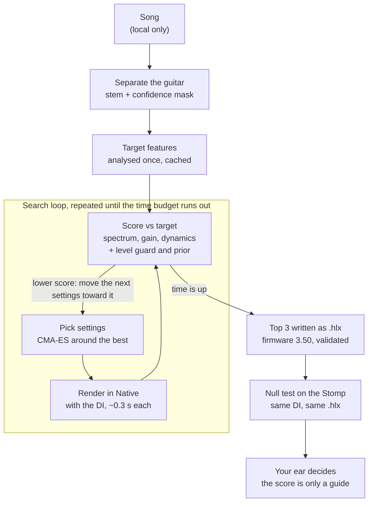

# How the Tone Comparison Works

*Last updated: 2026-10-15. Kept current by `tone-metrics` (comparison methods and trust results) and the lead (search, hardware check), whenever any of these details change; see "Keeping this document current" at the end.*

The matcher plays candidate presets through Helix Native and scores each one against the song's separated guitar using a set of spectral and dynamic measurements. It keeps adjusting the settings to lower that score. Those measurements are not yet trustworthy: none has passed its trust check. So the score points roughly the right way but cannot tell close candidates apart, and your ear is still the judge.

## At a glance

The target is analysed once. The search then loops pick, render, score until its time runs out. The best three are checked on the Stomp and by you.

## What is being compared

Every comparison is one audio clip against another: the **target** (the guitar we want) against a **candidate** (a DI, meaning a clean, unprocessed guitar recording, played through a trial preset). Nothing compares preset settings directly.

- **Target:** the guitar stem that the separator (`htdemucs_6s`) pulls out of the song, cut to the section being matched. For the first test song, DS-Sample, that is 34.5 to 42.0 s. It comes with a **confidence mask**: one number per sample from 0 to 1 saying how sure the separator is that this moment is guitar. Terms that use the mask ignore moments below its threshold.
- **Candidate:** a DI rendered through Helix Native with the trial settings. The DI is either a library clip (Guitar-TECHS) chosen to match the part's register and style, or your own recorded take.
- **Level:** every term is built to ignore overall loudness, because the stem's level in the mix is arbitrary. A separate **level guard** stops the search from turning the volume down to cheat. It did exactly that once: volume 0.004, 52 dB too quiet, and the score still improved.
- **Same performance or not:** with a library DI the notes and strumming differ from the song, so only measurements that ignore which notes are played can be used. With your own take the notes match but the timing does not line up to the sample, so the same rule applies.
- **Held fixed:** the chain layout (which blocks), the cab's Early Reflections (0, so the Stomp sounds the same as Native), and any parameter the engine cannot verify. Only the remaining parameters, mostly the amp's, are searched.

## The comparison methods

The score is built from separate measurements, called terms. Each one is a distance between the target's features and the candidate's. Each is designed to answer one question about the tone, and to ignore the notes played and the overall level.

| Term | Question it answers | How it is computed | Ignores | Used in the score now |
| --- | --- | --- | --- | --- |
| `ltas_tilt` (spectrum) | Is the frequency balance the same (cab, EQ, voicing)? | The FFT power spectrum averaged over active frames, grouped into overlapping 1/3-octave bands from 80 Hz to 12 kHz, mean removed. Plus spectral tilt, the slope in dB per octave. Distance is the weighted RMS band difference in dB plus the tilt difference. Bands below 320 Hz count less, because they move with the notes played. One unit is about 1 dB everywhere, or 0.5 dB per octave of tilt. | Level, which notes | Yes (weight 1, provisional) |
| `crest_flatness_hnr` (distortion) | Is the amount and kind of gain the same? | Per 2048-sample frame: crest factor (peak over RMS in dB; clipping lowers it), spectral flatness from 150 Hz to 8 kHz (distortion fills the gaps between harmonics and raises it), and harmonic-to-noise ratio from the autocorrelation peak. The median and spread of each across frames. | Level | Yes (weight 1, provisional) |
| `envelope` (dynamics) | Are compression, sag, gating and note attack the same? | Two level envelopes (10 ms and 2 ms). Note onsets are found by spectral flux across quarter-octave bands. From those: per-note attack time, decay slope and overshoot, sustain slope, dynamic range and noise floor. | Level, rhythm | Yes (weight 1, provisional) |
| `mrstft` (fine detail) | Does the spectrum match moment by moment? | Short-time FFTs at 512, 2048 and 8192 samples. Spectral convergence plus the mean log-magnitude difference, averaged over the three sizes. | Level only | No: it needs a sample-aligned DI of the same performance |
| `embed_afxrep` (learned) | Does a trained effects model think the processing is the same? | A neural network (AFx-Rep, from the ST-ITO paper) turns each clip into 512 numbers. Distance is 1 minus the cosine similarity. | Level, notes (by training) | No: weight 0, scored below the others |

The combined score is the weighted sum of the active terms. Today that is the three provisional terms, at weight 1 each. The project's default weights are all 0 until a term passes its trust check, so any score you see is explicitly labelled "unadmitted".

## How it iterates and decides

The search treats the score as a number to minimise. It never "hears" anything: it tries settings, renders, scores, and moves toward lower scores until its time budget runs out. It stops on time, not on reaching a good-enough score.

1. **Analyse the target once.** The target's features for every term are computed once and cached, so each candidate only costs its own render and analysis.
2. **Score the starting point** of each candidate chain. DS-Sample used 7 chains: Essex A15, Essex A30, Placater Dirty, US Deluxe and Brit Plexi amps with their cabs, some with the delay on. Each chain's settings are numbers from 0 to 1.
3. **Beam pass.** Each chain gets a short burst of CMA-ES, an evolutionary optimiser. It samples a cloud of settings around the current best, keeps the better half, and shifts and narrows the cloud toward them. The step size is 0.3, with about 30 renders per chain.
4. **Refine.** The best two chain structures share the remaining time, 60/40, with a smaller step size (0.15). On your take-6 run this took the winner from 7.65 to 6.94 over 181 renders.
5. **Guards added to every score:**
    - **Level guard:** free within plus or minus 6 dB of a reference level, then 0.5 points per extra dB.
    - **Weak neutral prior:** a small pull toward the middle of each knob, so settings do not run to the ends for no reason.
6. **Final check.** The top three are re-scored on the full section with the stem and the confidence mask, and the lowest wins. Each is written as an `.hlx` file for firmware 3.50, with snapshot values matching the block values.
7. **DI check.** The winner is scored on other DIs (your takes 4 and 5) to see how much the result depends on the performance.

**What it does not search yet:** which models to use (only the fixed chains), the cab parameters, and the drive, EQ, modulation and reverb blocks. The per-block library and the block probes are being built to change that.

**Cost:** a Native render takes about 0.3 s (it was about 2 s before the memory fix). A 25-minute budget therefore allows several thousand renders, not about 500.

## Hardware check: the null test

The search runs in Native, so a separate test checks that the HX Stomp plays the same preset the same way. Unlike the tone terms, this is an exact waveform comparison. It is possible because both engines get the identical DI and the identical `.hlx`.

1. Render the same DI through the Stomp (written into its edit buffer over USB, then read back and checked parameter by parameter) and through Native.
2. **Align** the two. FFT cross-correlation finds the delay to the nearest sample, then a fine search finds the fractional part. That is typically 3 to 11 samples, under 0.25 ms.
3. **Level-match:** one least-squares gain makes the Stomp render as close as possible to Native's.
4. **Subtract** and measure what is left, relative to the signal: the null, in dB. Lower is closer. The script also reports it per octave band and over the delay tail.

| Preset | Null | Reading |
| --- | --- | --- |
| K, A, B0 (no delay, Early Reflections 0) | -30.4 to -37.5 dB | Same as the pedal repeating itself, so the same sound |
| B (tempo-synced delay) | -19.1 dB | Delay time follows tempo differently in each engine |
| First DS-Sample match (Early Reflections 0.783) | -3.6 dB | Different sound: the cab's Early Reflections differ between firmware 3.50 and Native 3.82 |
| DS-Sample matches with Early Reflections fixed at 0 | -31.4 and -30.5 dB | Same sound |

This test is reliable and has already caught one real mismatch. Its limit is that it checks the engines against each other, not against the song.

## Is it indicating properly?

Partly. It reliably tells **very different** tones apart, but it cannot yet tell **close** tones apart, which is exactly what fine matching needs.

**How a method is tested (the trust check).** Make a target from a known preset, then make 15 "distractors": 7 near ones (the true preset with one group of settings changed) and 8 random ones. A method passes if it ranks the true preset first. Chance is 1 in 16 (0.0625). The bar to be trusted is 0.90 per method and 0.95 for the combined score. So far this has only been run on stand-in signals (simple digital effects in code), not Helix, because the Helix test set is not rendered yet.

| Method | Rank-1, different notes | Rank-1, same notes | Notes |
| --- | --- | --- | --- |
| `ltas_tilt` (spectrum) | 0.13 to 0.23 | 0.29 to 0.38 | Best single method; 0.90 against random distractors only |
| `crest_flatness_hnr` (distortion) | 0.10 | 0.30 | |
| `envelope` (dynamics), v1 | 0.12 to 0.15 | 0.24 to 0.33 | Was 0.03 to 0.05 before the rework |
| `mrstft` (fine detail) | 0.00 | 0.78 | Only works with the same performance, sample-aligned |
| `embed_afxrep` (learned) | 0.07 | 0.08 | Confused by separation artifacts |
| Combined (spectrum + distortion + dynamics) | 0.28 to 0.33 | 0.38 | Bar is 0.95; 0.95 against random distractors only |

The ranges cover the separate seed sets each method was tested on.

**What real use has shown:**

- **Your ear disagreed with it.** On your take 6 the score put the Essex A15 first (6.935) and the Placater second (6.950). You preferred the Placater. A 0.015 gap means the score had no real opinion.
- **It pushes settings to the ends of their range.** Cut is at its minimum, and Master, Channel Volume and Sag are near their maximum. That suggests the score rewards extremes rather than the tone.
- **It depends heavily on the DI.** One preset scored 7.7, 11.0 and 22.7 on three library DIs. On your own three takes it scored 6.94, 7.27 and 8.08. Your own playing makes it far more stable.
- **It liked more delay than you did.** You found the delay much better at Mix 0.10 than at the matched 0.25.
- **The target itself is imperfect.** You heard that the separated stem is missing fidelity, and every method compares against that stem.

**Bottom line:** treat the score as a rough guide that finds the right neighbourhood, and your listening as the decision.

## What would make it trustworthy

1. **Render the Helix test set** (180 known presets) and run the trust check on real Helix tones instead of stand-ins. No method can be admitted without it.
2. **Probe each block** with sine sweeps, stepped sines, two-tone signals, bursts and impulses. The analysis kit is built and verified on synthetic blocks. It shows how each control changes frequency response, clipping and dynamics, so the search can start near the right settings.
3. **Build the per-block library**, with every Stomp-compatible block captured alone. Chaining single blocks was shown to sound the same as one chain (null -67 to -79 dB). The search can then choose models, not just a few fixed chains.
4. **Use your own aligned takes**, so the fine-detail method (`mrstft`, 0.78 with the same notes) can join the score.
5. **Collect your listening verdicts** in blind A/B sessions and check the score against them. Where they disagree, the score changes, not your ear.

## Sources

All from this repository:

- [`src/tonematch/metrics/`](../src/tonematch/metrics/): the comparison methods (`kit.py`, `ltas.py`, `crest.py`, `envelope.py`, `mrstft.py`, `afxrep.py`)
- [`scripts/match_song.py`](../scripts/match_song.py): the search and the end-to-end run
- [`scripts/parity_null.py`](../scripts/parity_null.py) and [`ledger/runs.csv`](../ledger/runs.csv) (kind `parity`): the null tests
- [`scripts/loss_trust_check.py`](../scripts/loss_trust_check.py) and [`ledger/runs.csv`](../ledger/runs.csv) (kind `loss-trust`, dataset `proxy-dsp-v0`): the trust-check numbers
- [`docs/DECISIONS.md`](DECISIONS.md): the Early Reflections finding, the memory fix, block-serial rendering, snapshot values
- [`reports/status/README.md`](../reports/status/README.md): the overall project status

## Keeping this document current

Update this file in the same change whenever any of these changes: a comparison term or its weights (`tone-metrics`), a trust-check result (`tone-metrics`, `benchmark`), how the search iterates or its guards (`search`), the hardware null test or a new parity finding (`benchmark`, `stomp-engine`), or a human listening verdict that contradicts the score (lead). The lead checks it at every `plan-sync`. Update the "Last updated" date at the top.
