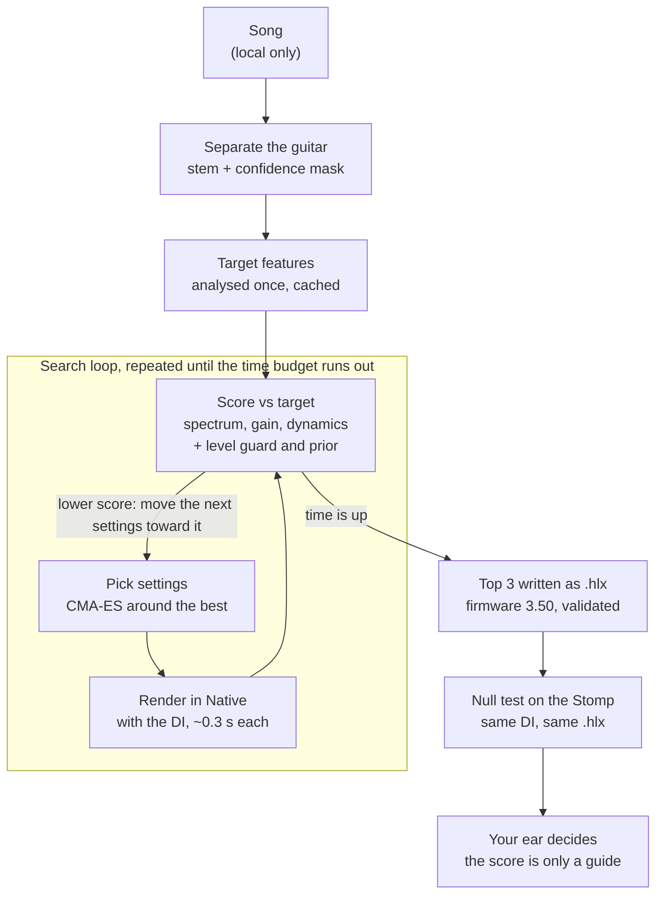

# How the Tone Comparison Works

*Last updated: 2026-10-17 (chain builder written and tested on fake engines only; earlier: 2026-10-16 (fine-detail method retuned as `mrstft_v2` and passed its trust check with a matching DI, proposed for admission; earlier the same day: search moves delay time, modulation speed and reverb decay; purpose-made test signals; flanger and phaser closed). Kept current by `tone-metrics` (comparison methods and trust results) and the lead (search, hardware check), whenever any of these details change; see "Keeping this document current" at the end.*

The matcher plays candidate presets through Helix Native and scores each one against the song's separated guitar using a set of spectral and dynamic measurements. It keeps adjusting the settings to lower that score. Those measurements are not yet trustworthy when the notes differ: none of those has passed its trust check. With a lined-up DI of the same performance, the retuned fine-detail method (`mrstft_v2`) passed (0.99) and is proposed for admission. On real Helix sounds (tested 2026-10-16) the score tells clearly different chains apart some of the time, but when the notes played differ from the target it cannot tell close settings apart at all. Your ear is still the judge.

## At a glance

The target is analysed once. The search then loops pick, render, score until its time runs out. The best three are checked on the Stomp and by you.

## What is being compared

Every comparison is one audio clip against another: the **target** (the guitar we want) against a **candidate** (a DI, meaning a clean, unprocessed guitar recording, played through a trial preset). Nothing compares preset settings directly.

- **Target:** the guitar stem that the separator (`htdemucs_6s`) pulls out of the song, cut to the section being matched. For the first test song, DS-Sample, that is 34.5 to 42.0 s. It comes with a **confidence mask**: one number per sample from 0 to 1 saying how sure the separator is that this moment is guitar. Terms that use the mask ignore moments below its threshold.
- **Candidate:** a DI rendered through Helix Native with the trial settings. The DI is either a library clip (Guitar-TECHS) chosen to match the part's register and style, or your own recorded take.
- **Level:** every term is built to ignore overall loudness, because the stem's level in the mix is arbitrary. A separate **level guard** stops the search from turning the volume down to cheat. It did exactly that once: volume 0.004, 52 dB too quiet, and the score still improved.
- **Same performance or not:** with a library DI the notes and strumming differ from the song, so only measurements that ignore which notes are played can be used. With your own take the notes match but the timing does not line up to the sample, so the same rule applies.
- **Held fixed:** the chain layout (which blocks), the cab's Early Reflections (0, so the Stomp sounds the same as Native), and any parameter the engine cannot verify. Only the remaining parameters, mostly the amp's, are searched.

## The comparison methods

The score is built from separate measurements, called terms. Each one is a distance between the target's features and the candidate's. Each is designed to answer one question about the tone, and to ignore the notes played and the overall level.

| Term | Question it answers | How it is computed | Ignores | Used in the score now |
| --- | --- | --- | --- | --- |
| `ltas_tilt` (spectrum) | Is the frequency balance the same (cab, EQ, voicing)? | The FFT power spectrum averaged over active frames, grouped into overlapping 1/3-octave bands from 80 Hz to 12 kHz, mean removed. Plus spectral tilt, the slope in dB per octave. Distance is the weighted RMS band difference in dB plus the tilt difference. Bands below 320 Hz count less, because they move with the notes played. One unit is about 1 dB everywhere, or 0.5 dB per octave of tilt. | Level, which notes | Yes (weight 1, provisional) |
| `crest_flatness_hnr` (distortion) | Is the amount and kind of gain the same? | Per 2048-sample frame: crest factor (peak over RMS in dB; clipping lowers it), spectral flatness from 150 Hz to 8 kHz (distortion fills the gaps between harmonics and raises it), and harmonic-to-noise ratio from the autocorrelation peak. The median and spread of each across frames. | Level | Yes (weight 1, provisional) |
| `envelope` (dynamics) | Are compression, sag, gating and note attack the same? | Two level envelopes (10 ms and 2 ms). Note onsets are found by spectral flux across quarter-octave bands. From those: per-note attack time, decay slope and overshoot, sustain slope, dynamic range and noise floor. | Level, rhythm | Yes (weight 1, provisional) |
| `mrstft` (fine detail) | Does the spectrum match moment by moment? | Short-time FFTs at 512, 2048 and 8192 samples. Spectral convergence plus the mean log-magnitude difference, averaged over the three sizes. | Level only | No: it needs a sample-aligned DI of the same performance |
| `mrstft_v2` (fine detail, retuned) | The same question, asked better | The same three FFT sizes, but the spectrum is grouped into 64 bands spaced like the ear's frequency resolution (ERB bands), and the distance is the summed absolute difference of band magnitudes divided by the target's total. Version 2.0, chosen on training items only. | Level only (so it cannot see an Output knob) | Proposed for admission when a matching DI exists (passed 0.99); not yet switched on |
| `embed_afxrep` (learned) | Does a trained effects model think the processing is the same? | A neural network (AFx-Rep, from the ST-ITO paper) turns each clip into 512 numbers. Distance is 1 minus the cosine similarity. | Level, notes (by training) | No: weight 0. About 0.11 s per 10 s clip on the CPU, half a Native render |

The combined score is the weighted sum of the active terms. Today that is the three provisional terms, at weight 1 each. The project's default weights are all 0 until a term passes its trust check, so any score you see is explicitly labelled "unadmitted".

## How it iterates and decides

The search treats the score as a number to minimise. It never "hears" anything: it tries settings, renders, scores, and moves toward lower scores until its time budget runs out. It stops on time, not on reaching a good-enough score.

1. **Analyse the target once.** The target's features for every term are computed once and cached, so each candidate only costs its own render and analysis.
2. **Score the starting point** of each candidate chain. DS-Sample used 7 chains: Essex A15, Essex A30, Placater Dirty, US Deluxe and Brit Plexi amps with their cabs, some with the delay on. Each chain's settings are numbers from 0 to 1.
3. **Beam pass.** Each chain gets a short burst of CMA-ES, an evolutionary optimiser. It samples a cloud of settings around the current best, keeps the better half, and shifts and narrows the cloud toward them. The step size is 0.3, with about 30 renders per chain.
4. **Refine.** The best two chain structures share the remaining time, 60/40, with a smaller step size (0.15). On your take-6 run this took the winner from 7.65 to 6.94 over 181 renders.
5. **Guards added to every score:**
    - **Level guard:** free within plus or minus 6 dB of a reference level, then 0.5 points per extra dB.
    - **Weak neutral prior:** a small pull toward the middle of each knob, so settings do not run to the ends for no reason.
6. **Final check.** The top three are re-scored on the full section with the stem and the confidence mask, and the lowest wins. Each is written as an `.hlx` file for firmware 3.50, with snapshot values matching the block values.
7. **DI check.** The winner is scored on other DIs (your takes 4 and 5) to see how much the result depends on the performance.

**Chain builder (written 2026-10-17, tested on fake engines only, not yet run on Native).** The human's direction is to model single blocks and build the chain from the analysis. The builder works in this order: measure which block types the target seems to contain; ask the chain-pattern model for the few most likely orderings of those types; for each ordering pick a short list of models per position, tune one position at a time with the others held still, then tune everything together a little; give the orderings that score worst less time at each round (halving) and keep the best. A chain is rendered one single-block template after another, each result shifted back by 16 samples, which the Native checks showed matches a real chain to within -60 dB. With a known DI it uses the admitted fine-detail comparison plus the level guard keyed to the target's own loudness; without one the weights are provisional and the result says so. Cost is counted in single-block renders and capped.

**What it does not search yet:** which models to use (only the fixed chains), the cab parameters, and the drive, EQ, modulation and reverb blocks. The per-block library and the block probes are being built to change that.

**Cost:** a Native render takes about 0.3 s (it was about 2 s before the memory fix). A 25-minute budget therefore allows several thousand renders, not about 500.

## Hardware check: the null test

The search runs in Native, so a separate test checks that the HX Stomp plays the same preset the same way. Unlike the tone terms, this is an exact waveform comparison. It is possible because both engines get the identical DI and the identical `.hlx`.

1. Render the same DI through the Stomp (written into its edit buffer over USB, then read back and checked parameter by parameter) and through Native.
2. **Align** the two. FFT cross-correlation finds the delay to the nearest sample, then a fine search finds the fractional part. That is typically 3 to 11 samples, under 0.25 ms.
3. **Level-match:** one least-squares gain makes the Stomp render as close as possible to Native's.
4. **Subtract** and measure what is left, relative to the signal: the null, in dB. Lower is closer. The script also reports it per octave band and over the delay tail.

| Preset | Null | Reading |
| --- | --- | --- |
| K, A, B0 (no delay, Early Reflections 0) | -30.4 to -37.5 dB | Same as the pedal repeating itself, so the same sound |
| B (tempo-synced delay) | -19.1 dB | Delay time follows tempo differently in each engine |
| First DS-Sample match (Early Reflections 0.783) | -3.6 dB | Different sound: the cab's Early Reflections differ between firmware 3.50 and Native 3.82 |
| DS-Sample matches with Early Reflections fixed at 0 | -31.4 and -30.5 dB | Same sound |

### Spot checks across block types (firmware 3.80, 2026-10-16)

The same null test was run on 47 more files, one block changed at a time in the smoke chain (amp, cab, and one effect after the cab), all on Stomp firmware 3.80 against Native 3.82, with amp Hum and Ripple at 0 and the cab's Early Reflections at 0. A clean guitar clip of 4 s plus 2 s of silence was used. "Same sound" means a null of -30 dB or lower.

| Block type | Models checked | Same sound | What was found |
| --- | --- | --- | --- |
| Amp | 5 | 5 | -37.5 to -47.5 dB |
| Cab (including one IR-style cab) | 5 | 5 | -35.4 to -37.4 dB |
| Dynamics (five compressors and a noise gate) | 6 | 6 | -33.6 to -37.2 dB |
| EQ | 5 | 5 | -30.5 to -40.6 dB |
| Distortion | 5 | 2 | Scream 808 -30.9 and Kinky Boost -33.5 pass; Heavy Dist -25.7, Bitcrusher -27.4 and Triangle Fuzz -28.6 are close but miss |
| Reverb | 6 | 0 | -5.9 to -22.8 dB; the pedal repeats itself to -77.7 dB (Room), so the difference is real: reverb tails are not the same algorithm settings-for-settings |
| Delay | 5 | echo level 5 of 5 | Echoes are as loud on both (within 0.5 dB) but arrive at slightly different times: Native is about 3 ms later per echo (0.8% of the delay time) on four models and about 2 ms earlier on Adriatic Delay (this was Native's 63 ms step in delay time, see the second pass below, not a difference between the engines), so the waveforms cannot null (-5 to -12 dB). Delays are judged by echo level and timing, not by null |
| Modulation | 6 | 0 | -1.0 to -9.0 dB; the pedal does not repeat itself (-1.5 dB on a chorus rendered twice) because its LFO starts at a random point, so modulation cannot be judged by a null at all |

Cab Early Reflections on firmware 3.80, same cab and clip: 0 gives -28.1 dB, 0.25 gives -12.1, 0.5 gives -6.6 and 1.0 gives -1.0 dB. That is the same pattern as on firmware 3.50, so upgrading did not fix it and Early Reflections stays held at 0 for anything bound for the pedal.

Some models (Simple, Transistor Tape and Adriatic delays, and five modulation effects) had parameters in the catalog that the Stomp's block does not have (Scale, Spread, Stereo); the Stomp refused those files until the parameters were left out. Both engines then used their own default for them.

### Delays, reverbs, modulation and drives judged by measurement (2026-10-16)

A null is the wrong test for effects that move in time. A delay whose clock runs 1 % slow, a reverb with a different but equally long tail, or a chorus whose wobble started at another point all fail a null while sounding alike. So the same saved renders were measured instead, effect by effect. Nothing was re-rendered. Each measurement is compared with a proposed tolerance tied to what listeners can just tell apart (the "just-noticeable difference" in hearing studies), for example 1 dB for a level, 5 % for a decay time and 2 % for a delay time. Where one 4 s guitar clip cannot measure something precisely enough, the result says "unresolved" rather than pass or fail.

| Block type | What was measured | Result |
| --- | --- | --- |
| Delay (5) | Time and level of each echo, how fast the echoes die away | All 5 within tolerance. Echo levels within 0.7 dB. Native's echoes come 0.8 % late (378 ms instead of 375 ms) on four models and 0.6 % early on Adriatic. That is under 10 ms in total over the echoes you can hear at this setting, but it adds up on long delays |
| Distortion (5) | Spectrum in 1/3-octave bands, the level of each harmonic, noise, level | Same tone on all 5: spectra within 0.45 dB, harmonics within 0.3 dB, level within 0.2 dB. The failed nulls come from a tiny timing difference (about 5 microseconds) in the amp and open cab before the drive: that chain alone nulls at only -28 dB with spectra within 0.06 dB. Bitcrusher adds a little more aliasing on the Stomp |
| Reverb (6) | Decay time per octave (early decay and full decay), when the reverb starts after the note (pre-delay), the tail's spectrum and level | Decay at 4 kHz within 2.3 % on all 6. Pre-delay differs by 5.3 ms on Hall and 4.8 ms on Chamber (Native starts earlier); at most 0.8 ms on the other four. Ganymede, which has its own modulation, decays 7 to 11 % faster on Native at 1 to 2 kHz. Low-frequency decay, the tail's spectrum and its level cannot be measured precisely enough from a 2 s tail of a guitar clip |
| Modulation (6) | How fast the effect wobbles (rate), how deep, and the sound with the wobble averaged out | Tremolo matches (6.73 vs 6.76 Hz, depth 9.0 vs 9.2 dB). Chorus rate matches (1.78 vs 1.76 Hz) and so does its averaged sound; its depth may be about 25 % deeper on Native but this clip cannot confirm it. Vibrato agrees too (6.80 vs 6.76 Hz, depth 23 vs 24 cents) but the reading is just below the confidence bar. Flanger and phaser wobble too slowly for 4 s; the MM4 chorus gives no steady reading on this clip |

**What this means for now (a proposal to the lead, not yet accepted):** Native can stand in for the Stomp on amps, cabs, dynamics, EQ, drives, delays and tremolo. Reverbs, other modulation, bitcrusher-type drives and long delays still need the Stomp. Two short test signals for the next pedal session would settle most "unresolved" rows: a 10 s steady tone for modulation and a noise burst with 6 s of silence for reverb. (That session has now been run; see the next section, which also corrects the delay finding above.)

### Second pass with purpose-made test signals ([T066b](../board/TASKS.md#t066b "Parity probe session closing the T066 open questions"), firmware 3.80, 2026-10-16)

One pedal session and one Native batch rendered a noise burst followed by 6 s of silence (for reverb), two 10 s steady tones at 330 Hz and 1 kHz and a real guitar note held for about 4 s (for modulation), and a second delay time. Each effect was rendered twice on the Stomp, so the Stomp's own repeatability is known, and once on Native. A difference only counts when it is larger than what the measurement itself can tell apart: for reverbs, how much two different-but-equally-long reverbs would differ in one burst; for modulation, how much the Stomp differs from itself.

**The delay finding is corrected.** Native does not take a knob value exactly: every setting reaches it through a 128-step control, so a delay time can only be a multiple of 63 ms (its range is 0 to 8 s). Asked for 375 ms, Native plays 378 ms (that was the "0.8 % late"); asked for 600 ms, it plays 630 ms (5 % late); asked for 200 ms, 189 ms. The Stomp plays exactly what the file says (600.0002 ms). So the lateness is not a difference between the engines, and the planned correction of 1.0079 on export is not needed and would add an error. When the search finishes, the preset holds the value Native actually played, and the Stomp plays that same value exactly. What is real is the coarse step: Native's search can only place a delay time to within about 31 ms, which is a design question for the search. **Update (2026-10-16):** the search now moves delay time, modulation speed, reverb decay and frequency settings (before, it only moved knobs that run from 0 to 1), each over its own range, so a delay time steps in 10 ms and a 0-1.27 s time and a 0-1 knob get comparable step sizes. Blocks that sound different on every pass (Octo Reverb, Glitch Delay, Shuffling Delay) are left out of the candidate pool unless asked for, and a chain that holds one is flagged because its null-based score is unreliable.

The same stepping explains the modulation speeds that looked different. The Deluxe Phaser was asked for 0.20 Hz and Native plays 0.236 Hz (+18 %); the measured difference was +18 %. The MM4 chorus was asked for 1.59 Hz and Native plays 1.535 Hz (-3.4 %); measured -3.4 %. After allowing for the stepping, both are equal to within 0.03 %.

| Block | What was measured | Result |
| --- | --- | --- |
| Reverb: Room, Plate, '63 Spring, Chamber | Full decay time per octave band; when the reverb starts | Decay within the 5 % tolerance everywhere it can be measured (2 and 4 kHz on Room and Chamber; 0.5, 1 and 4 kHz on Plate; 0.5 to 4 kHz on '63 Spring); at the lower octaves the measurement is too noisy to tell. The reverb starts within 0.8 ms on both engines. Nothing is outside tolerance |
| Reverb: Hall | Same | Decay and start match from 1 kHz up (within 1.1 %); at 250 Hz Native's decay is 8.2 % shorter, outside tolerance. The 5 ms difference in when it starts seen in the first pass was an artefact of the guitar clip: with a noise burst it is 0.0 ms |
| Reverb: Ganymede (modulated) | Same | Native decays 11 % faster at 500 Hz and 1 kHz and 6 % slower at 4 kHz: outside tolerance. The Stomp does not repeat itself exactly on this one either (up to 6.7 %) |
| Every reverb | Early decay, spectrum and level of the tail | Still cannot be judged: two reverbs of identical length differ by 7 to 110 % (early decay), 3 to 6 dB (spectrum) and 1.2 to 1.8 dB (level) in one burst. What was measured (level within 0.7 dB, spectrum shape within 1.4 to 4.1 dB) is inside that noise |
| Modulation: 70s Chorus, Bubble Vibrato, MM4 Analog Chorus | Speed, depth of pitch swing, level at the tone | Match on both steady tones and on the real guitar note. Speed within 0.5 % (MM4 3.4 %, none after the stepping), pitch swing within 2 cents, level within 0.4 dB. The Stomp repeats itself within 0.1 % in speed |
| Modulation: Gray Flanger, Deluxe Phaser | Same | Cannot be called yet: at their default settings they cycle every 6.1 s and 5.0 s, so 10 s holds fewer than the 2 cycles needed. For what it is worth the Flanger agrees (speed within 0.9 %, depth within 0.6 dB), and the Phaser's difference in speed is exactly the stepping described above |
| Delay at a second time (600 ms) | Echo times, levels, decay | Echo levels within 0.2 dB and the same decay on both; times differ only by the stepping |

**What this means for now (a proposal to the lead, not yet accepted):** Native can stand in for the Stomp on Room, Plate, '63 Spring and Chamber reverbs, on Hall above 500 Hz, on 70s Chorus, Bubble Vibrato and MM4 chorus, and on delays of any length (the exported delay time is the one Native played). Ganymede still needs the Stomp, and Hall for bass-heavy targets. Gray Flanger and Deluxe Phaser need one more short pedal session with a 20 s steady tone and the stepped values written to the Stomp file. **Result of that session (2026-10-16):** the test writes Native's stepped values into the Stomp file by itself before every pedal run (a standing rule for all comparison scripts). With 20 s tones, both engines read the Gray Flanger at 0.163 Hz (3.1 cycles) and the Deluxe Phaser at 0.236 Hz (4.6 cycles), speeds equal to within 0.1 %; the depth of the sweep differs by at most 0.45 dB and the average level at the tone by under 1 dB (0.05 dB at 1 kHz). Both pass, so the proposal to the lead is that Native can stand in for them too. Both engines used the same, older step ranges, which does not matter for this comparison. Only the default settings of each effect were measured. Earlier comparisons that asked Native for exact values (the first pass above) carry the stepping error on Native's side wherever a setting has a wide range.

This test is reliable and has already caught one real mismatch. Its limit is that it checks the engines against each other, not against the song.

## Is it indicating properly?

Not yet. On real Helix sounds it often, but not reliably, tells **clearly different** chains apart. When the candidate's notes differ from the target's, it cannot tell **close** settings apart at all, and that is exactly what fine matching needs.

**How a method is tested (the trust check).** Take a preset whose settings we know, play a DI through it in Helix Native, and call that the target. Then line up 20 candidates: the true preset plus 19 "distractors". Every candidate is played from a different DI clip than the target, because in real use the library DI never plays the same notes as the song. A method passes if it scores the true preset best. With 20 candidates, guessing gets it right 1 time in 20 (0.05). The bar `benchmark` has proposed (not yet agreed) is 0.90 for each method and 0.95 for the combined score.

**The Helix test (2026-10-16, test set `helix-trust-v1`).** 40 target presets, 5 in each of drive, amp, cab, delay, reverb, dynamics, EQ and modulation, each built from the same amp and cab with one block changed. For each target the 19 distractors are:

- 9 **near misses**: the same block with one or two knobs moved by 12-30% of their range;
- 4 or 5 **neighbouring models**: the other blocks of the same kind (for a delay target, the other delays), at random settings;
- 5 or 6 **random** chains with a block of another kind.

That is 2,400 Native renders of 10 s each, using guitar recordings from the Guitar-TECHS library. Three ways of choosing the candidates' DI were tried:

- **Different notes:** another passage of the same recording, so the same player and guitar but different notes. This is the main test for methods that do not need the same performance.
- **Different recording:** another player, guitar or playing style.
- **Same notes:** the target's own DI. Only here is the fine-detail method (`mrstft`) valid. The target is then passed through a stand-in for the separator (it adds bleed from other instruments and mask errors), because a clean target would be identical to the true candidate.

| Method | Different notes | Different recording | Same notes, after separation stand-in | Beats random chains (different notes) | Beats near misses (different notes) |
| --- | --- | --- | --- | --- | --- |
| `ltas_tilt` (spectrum) | 0.03 | 0.05 | 0.35 | 0.55 | 0.03 |
| `crest_flatness_hnr` (distortion) | 0.13 | 0.03 | 0.40 | 0.53 | 0.13 |
| `envelope` (dynamics) | 0.05 | 0.00 | 0.15 | 0.38 | 0.08 |
| `mrstft` (fine detail) | 0.18 (not a valid use) | 0.08 | **0.73** | 0.88 | 0.18 |
| `embed_afxrep` (learned) | 0.15 | 0.08 | 0.08 | 0.78 | 0.15 |
| Combined (spectrum + distortion + dynamics) | 0.05 | 0.03 | 0.33 | 0.68 | 0.05 |

Each number is the share of the 40 targets where the true preset scored best. With 40 targets, a measured 0.15 could really be anywhere from about 0.07 to 0.30. **No method comes near 0.90, so none is admitted.** The earlier stand-in tests (simple digital effects written in code) had suggested 0.10-0.33 with different notes. Real Helix sounds are harder.

**Why it fails.** Playing different notes through the *same* preset changes every measurement 4.5 to 10 times more than moving one or two knobs does. For the spectrum method, the note change alone moves the score by about 2.1 units (about 2 dB across the spectrum), a near miss by about 0.2, and a different model of the same block by about 1.8. So once the notes differ, a near miss is invisible and a neighbouring model is hard to separate. The learned method (`embed_afxrep`) holds up best against random chains (the note change is only about a fifth of the gap to a random chain), but it is no better on near misses.

**Some distractors cannot be told apart by anyone.** 78 of the 760 distractors (10%) sound the same as the true preset: played with the same notes, the difference between them is 30 dB or more below the signal. Examples are a drive's tone knob moved slightly in front of a clean amp, or a compressor that barely engages. The report gives the rank-1 rate against audible distractors only alongside the plain rate. It is higher (for example 0.33 for `embed_afxrep` and 0.88 for `mrstft` with the same notes) but still below the bar.

**What this means in use.** With a library DI, the score can find the right kind of chain (it beats random chains about half to three-quarters of the time), but it cannot fine-tune settings. Fine-tuning needs your own take of the same part, lined up with the song, so that `mrstft` can be used (0.73 here, 0.88 against audible distractors).

**Cost per candidate** (10 s clip): the Native render takes 0.23 s with 3 render processes running in parallel. Scoring adds 0.008 s for spectrum, 0.012 s for dynamics, 0.034 s for distortion, 0.064 s for fine detail and 0.11 s for the learned method.

**What real use has shown:**

- **Your ear disagreed with it.** On your take 6 the score put the Essex A15 first (6.935) and the Placater second (6.950). You preferred the Placater. A 0.015 gap means the score had no real opinion.
- **It pushes settings to the ends of their range.** Cut is at its minimum, and Master, Channel Volume and Sag are near their maximum. That suggests the score rewards extremes rather than the tone.
- **It depends heavily on the DI.** One preset scored 7.7, 11.0 and 22.7 on three library DIs. On your own three takes it scored 6.94, 7.27 and 8.08. Your own playing makes it far more stable.
- **It liked more delay than you did.** You found the delay much better at Mix 0.10 than at the matched 0.25.
- **The target itself is imperfect.** You heard that the separated stem is missing fidelity, and every method compares against that stem.

**How far to trust the separated stem (stress curve `sep-stress-v1`, 2026-10-16).** Guitar-TECHS DI through a plain amp stand-in, mixed with synthetic bass, drums, keys and a second guitar, separated with `htdemucs_6s` on MPS (39 mixes of 20 s, about 3 s each). Guitar SDR falls from about 21 dB (guitar alone) to 15.9 (plus bass), 15.4 (plus drums), 11.2 (plus keys) and 7.3 dB (full band with a second guitar); at guitar 6 dB below the accompaniment the full band falls to 3.9 dB. The tone terms move too: the spectrum term (`ltas_tilt`) between the true and separated stem goes from 2.0 to 2.6, and the tilt is off by 0.6 to 0.8 dB per octave, against 3.4 for a clean-versus-driven amp change. So separation error on dense mixes is as large as a clear amp change, and spectrum comparison inside the dense sections is not safe on its own. The confidence proxy barely moves (0.93 to 0.90) while SDR falls by 14 dB, so it ranks mixes but does not warn early; the masked comparison did not reduce the shift. Prefer exposed-guitar windows and the separation-consistent comparison for dense sections. Caveat: accompaniment is synthetic and the amp is a stand-in, so real songs are unmeasured.

**With a matching DI, the fine-detail method now passes (test set `helix-trust-v2`, 2026-10-16).** This test covers the case where the candidate is played from exactly the same DI as the target, lined up to the sample. That is how Gate 2's synthetic recovery works, and how a song works once you supply a lined-up take. 192 target presets, each a single block (drive, delay, reverb, compressor, EQ, modulation, amp or cab), with 19 distractors each: 9 near misses, 4 neighbouring models and 6 random blocks. They are split in half. The method was tuned on one half only, with different block models and different DI recordings. It was then scored once on the other half. Each target is tested two ways:

- **Aligned:** the target as a real lined-up capture would give it, with up to half a sample of timing error, up to 3 dB of level difference, and faint noise 60 dB down.
- **After separation:** the separation stand-in on top (bleed from other instruments, mask errors).

Distractors that sound the same as the true preset count as ties, not failures. "Sound the same" means that, played with the same notes, the difference is 30 dB or more below the signal; 118 of the 1,824 test distractors are like that.

| Method | Aligned: right preset first | After separation | Worst category (aligned) |
| --- | --- | --- | --- |
| `mrstft` (before tuning) | 0.78 | 0.85 | cab 0.00 |
| `mrstft_v2` 2.0 (tuned) | **0.99** | **0.95** | drive 0.92 (after separation: drive 0.67) |

The bar is 0.90, so `mrstft_v2` passes in both conditions. The training half gave the same numbers (0.99 and 0.95), so the tuning did not overfit. The change that mattered was comparing band magnitudes on an ear-like frequency scale, using the plain (not logarithmic) magnitude difference. Excluding quiet frames and other ways of matching level made no difference or made it worse.

The failures are mostly distractors that only turn a drive's Output knob. They are the same sound 4 to 14 dB louder or quieter, which this method ignores by design: loudness is the level guard's job. The rest are near misses that the separation stand-in hides, such as a tilt EQ moved by about 1 dB.

It is proposed to the lead as the only term in the score when a matching DI exists, at weight 1. It is not switched on yet: the lead decides, and two things in Gate 2's own check need changing first (see docs/DECISIONS.md, [T096](../board/TASKS.md#t096 "Gate 2 option A + rule B")). It does not help with a library DI, where the notes differ.

**Bottom line:** treat the score as a rough guide that finds the right neighbourhood, and your listening as the decision.

## What would make it trustworthy

1. **Make the methods ignore the notes played** well enough to see a near miss. On the Helix test, a note change moves every method 4.5 to 10 times more than a near miss does (see above). Ideas to try: compare notes of the same pitch region rather than whole-clip averages, average over several DI passages, use longer clips, and train a guitar-specific learned method on Helix renders. Each is re-checked on the Helix test set.
2. **Probe each block** with sine sweeps, stepped sines, two-tone signals, bursts and impulses. The analysis kit is built and verified on synthetic blocks. It shows how each control changes frequency response, clipping and dynamics, so the search can start near the right settings.
3. **Build the per-block library**, with every Stomp-compatible block captured alone. Chaining single blocks was shown to sound the same as one chain (null -67 to -79 dB). The search can then choose models, not just a few fixed chains.
4. **Use your own aligned takes**, so the fine-detail method can join the score. Its retuned version (`mrstft_v2`) passes with a matching DI (0.99 aligned, 0.95 after separation, see above) and is proposed for admission.
5. **Collect your listening verdicts** in blind A/B sessions and check the score against them. Where they disagree, the score changes, not your ear.

## Sources

All from this repository:

- [`src/tonematch/metrics/`](../src/tonematch/metrics/): the comparison methods (`kit.py`, `ltas.py`, `crest.py`, `envelope.py`, `mrstft.py`, `mrstft_v2.py`, `afxrep.py`; `trust.py` holds the same-sound tie rule)
- [`scripts/match_song.py`](../scripts/match_song.py): the search and the end-to-end run
- [`scripts/parity_null.py`](../scripts/parity_null.py) and [`ledger/runs.csv`](../ledger/runs.csv) (kind `parity`): the null tests
- [`scripts/parity_timefx.py`](../scripts/parity_timefx.py), [`src/tonematch/metrics/parity.py`](../src/tonematch/metrics/parity.py) (tolerances) and the measurements in `delay.py`, `reverb.py`, `modulation.py`, `nonlinear.py`; ledger dataset `parity-spot-fw380-timefx`: delays, reverbs, modulation and drives judged by measurement
- [`scripts/loss_trust_check.py`](../scripts/loss_trust_check.py), [`scripts/helix_trust_set.py`](../scripts/helix_trust_set.py) and [`ledger/runs.csv`](../ledger/runs.csv) (kind `loss-trust`; dataset `helix-trust-v1` for the Helix test, `proxy-dsp-v0` for the earlier stand-in tests): the trust-check numbers
- [`docs/DECISIONS.md`](DECISIONS.md): the Early Reflections finding, the memory fix, block-serial rendering, snapshot values
- [`reports/status/README.md`](../reports/status/README.md): the overall project status

## Keeping this document current

Update this file in the same change whenever any of these changes: a comparison term or its weights (`tone-metrics`), a trust-check result (`tone-metrics`, `benchmark`), how the search iterates or its guards (`search`), the hardware null test or a new parity finding (`benchmark`, `stomp-engine`), or a human listening verdict that contradicts the score (lead). The lead checks it at every `plan-sync`. Update the "Last updated" date at the top.
